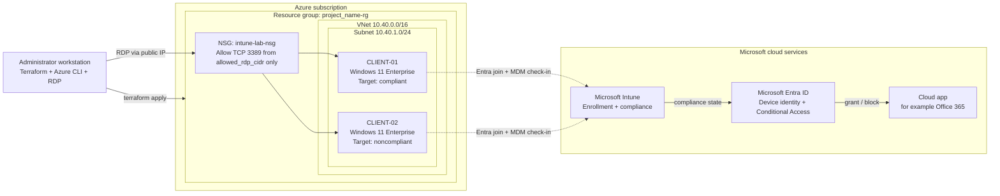

# Intune Compliance Lab on Azure

[](terraform/versions.tf)
[](terraform/versions.tf)
[](Set-Client02LabState.ps1)
[](docs/compliance-policies.md)
[](LICENSE)

A small, persistent **Windows 11 Enterprise lab on Azure** for practicing **Microsoft Intune device compliance** and **Microsoft Entra Conditional Access**. Terraform deploys two virtual machines. You then enroll them in Intune, assign a compliance policy, and deliberately push one device out of compliance to watch Intune evaluate, report, and (optionally) Conditional Access enforce.

> [!IMPORTANT]
> This repository automates **Azure infrastructure only**. Microsoft Entra join, Intune enrollment, compliance policies, and Conditional Access policies are **manual, post-deployment steps** documented in this repository. Nothing in Intune or Entra ID is created by Terraform.

---

## Contents

- [Objectives](#objectives)
- [What you will learn](#what-you-will-learn)
- [Lab features and scenarios](#lab-features-and-scenarios)
- [Architecture overview](#architecture-overview)
- [Technology stack](#technology-stack)
- [Prerequisites](#prerequisites)
- [Quick start](#quick-start)
- [Repository structure](#repository-structure)
- [Documentation](#documentation)
- [Expected lab outcomes](#expected-lab-outcomes)
- [Troubleshooting and support](#troubleshooting-and-support)
- [Contributing](#contributing)
- [License](#license)

## Objectives

| # | Objective |
|---|---|
| 1 | Deploy a repeatable, least-exposure Windows 11 lab on Azure with Infrastructure as Code. |
| 2 | Enroll Windows VMs into Microsoft Intune through Microsoft Entra join. |
| 3 | Build and assign a Windows compliance policy based on Firewall and Microsoft Defender settings. |
| 4 | Produce one **compliant** device (`CLIENT-01`) and one **noncompliant** device (`CLIENT-02`) and observe how Intune reports each. |
| 5 | Optionally, use Conditional Access in **Report-only** mode to see how compliance state affects access to cloud apps. |

## What you will learn

- The difference between **device configuration** (setting state), **compliance evaluation** (checking state), **reporting**, and **enforcement** (Conditional Access).
- How Entra join and automatic MDM enrollment bring a Windows device under Intune management.
- How Intune evaluates Windows Security Center–backed settings such as Firewall, Antivirus, and Real-time protection.
- How check-in timing, tenant-wide compliance settings, and Tamper Protection affect what you see in reports.
- How to roll out Conditional Access safely (Report-only, exclusions, sign-in log analysis).
- Why Intune management of Azure VMs has [documented limitations](docs/architecture.md#intune-on-azure-vms-limitations) compared with physical devices.

## Lab features and scenarios

| Component | Status | Where |
|---|---|---|
| Azure resource group, VNet, subnet | Implemented (Terraform) | [`terraform/main.tf`](terraform/main.tf) |
| NSG allowing RDP **only** from your `/32` | Implemented (Terraform) | [`terraform/security.tf`](terraform/security.tf) |
| Two Windows 11 Enterprise VMs with Trusted Launch (Secure Boot + vTPM) | Implemented (Terraform) | [`terraform/virtual-machines.tf`](terraform/virtual-machines.tf) |
| Pre-flight / deploy and guarded destroy helpers | Implemented (PowerShell) | [`scripts/`](scripts/) |
| `CLIENT-02` drift script (disable/restore Firewall and Defender RTP) | Implemented (PowerShell) | [`Set-Client02LabState.ps1`](Set-Client02LabState.ps1) |
| Entra join and Intune enrollment | Manual procedure | [Device enrollment](docs/device-enrollment.md) |
| Windows compliance policy | Manual procedure | [Compliance policies](docs/compliance-policies.md) |
| Conditional Access (require compliant device) | Optional manual procedure | [Conditional Access](docs/conditional-access.md) |

Guided scenarios are in [Lab scenarios](docs/lab-scenarios.md):

1. **Deploy the lab infrastructure**
2. **Enroll both VMs into Intune**
3. **Create and assign a compliance policy, and baseline both devices**
4. **Drive `CLIENT-02` noncompliant, then recover it**
5. **(Optional) Evaluate Conditional Access in Report-only mode**
6. **Clean up**

## Architecture overview



Solid lines are deployed or performed by the administrator. Dotted lines are manual post-deployment enrollment steps. See [Architecture](docs/architecture.md) for component relationships and design decisions.

## Technology stack

| Layer | Technology |
|---|---|
| Infrastructure as Code | Terraform `>= 1.6`, `hashicorp/azurerm ~> 4.0` (lock file pins 4.81.0) |
| Cloud platform | Microsoft Azure: Virtual Machines, Virtual Network, NSG, Standard Public IP |
| Guest OS | Windows 11 Enterprise, Marketplace image `MicrosoftWindowsDesktop/Windows-11/win11-24h2-ent` (default) |
| Identity | Microsoft Entra ID (device join, Conditional Access) |
| Endpoint management | Microsoft Intune (MDM enrollment, compliance policies) |
| Endpoint security | Windows Firewall, Microsoft Defender Antivirus |
| Automation | PowerShell, Azure CLI |

## Prerequisites

| Area | Requirement |
|---|---|
| Azure | Subscription and a role that can create resource groups, networks, and VMs (for example **Contributor**) |
| Tools | [Terraform CLI](https://developer.hashicorp.com/terraform/install), [Azure CLI](https://learn.microsoft.com/cli/azure/install-azure-cli), Remote Desktop client |
| Network | Your public IPv4 address (used as `allowed_rdp_cidr`, `/32`) |
| Licensing | Windows 11 Enterprise virtualization rights; Microsoft Intune Plan 1; Microsoft Entra ID P1 (automatic enrollment and Conditional Access) |
| Entra / Intune roles | Intune Administrator (or equivalent); Conditional Access Administrator for the optional scenario |

Full details: [Prerequisites](docs/prerequisites.md).

## Quick start

> [!WARNING]
> Deploying creates billable Azure resources. Review [cost notes](docs/prerequisites.md#cost-considerations) first.

```powershell
# 1. Clone and enter the Terraform directory
git clone https://github.com/emadadel2008/intune-compliance-lab.git
cd intune-compliance-lab\terraform

# 2. Sign in to Azure and select YOUR subscription
az login
az account set --subscription "YOUR_SUBSCRIPTION_ID"

# 3. Create your private variables file (git-ignored)
Copy-Item .\terraform.tfvars.example .\terraform.tfvars
notepad .\terraform.tfvars   # set location and allowed_rdp_cidr = "YOUR_PUBLIC_IP/32"

# 4. Pre-flight checks: init, fmt, validate, plan
..\scripts\deploy.ps1

# 5. Deploy (prompts for admin_password unless TF_VAR_admin_password is set)
terraform apply

# 6. Get connection details
terraform output
```

Then follow [Device enrollment](docs/device-enrollment.md) and [Lab scenarios](docs/lab-scenarios.md). The full walkthrough is in the [Setup guide](docs/setup-guide.md).

## Repository structure

```text
intune-compliance-lab/
├── README.md                      # This landing page
├── CHANGELOG.md                   # Notable changes
├── CONTRIBUTING.md                # Contribution and public-repo hygiene rules
├── LICENSE                        # MIT
├── Set-Client02LabState.ps1       # Runs inside CLIENT-02: Status / Apply / Restore
├── docs/                          # Detailed documentation (start at docs/index.md)
│   └── images/                    # Visual assets and screenshot capture list
├── scripts/
│   ├── deploy.ps1                 # Pre-flight: tool checks, init, fmt, validate, plan
│   └── destroy.ps1                # Destroy plan + typed confirmation
└── terraform/
    ├── versions.tf                # Terraform and provider constraints
    ├── providers.tf               # azurerm provider configuration
    ├── variables.tf               # Inputs and validation rules
    ├── main.tf                    # Resource group, VNet, subnet
    ├── security.tf                # NSG, RDP rule, NIC associations
    ├── virtual-machines.tf        # Public IPs, NICs, Windows 11 VMs
    ├── outputs.tf                 # RG name, VM names, public IPs, username
    ├── terraform.tfvars.example   # Safe placeholder values
    └── .terraform.lock.hcl        # Provider version lock
```

## Documentation

| Guide | Description |
|---|---|
| [Documentation home](docs/index.md) | Learning path and reading order |
| [Architecture](docs/architecture.md) | Azure topology, Intune/Entra relationships, and design decisions |
| [Prerequisites](docs/prerequisites.md) | Subscriptions, licenses, roles, tools, and cost |
| [Setup guide](docs/setup-guide.md) | Deploying and destroying the Azure infrastructure |
| [Device enrollment](docs/device-enrollment.md) | Entra join and Intune automatic enrollment of the VMs |
| [Compliance policies](docs/compliance-policies.md) | Policy design, evaluation, and state lifecycle |
| [CLIENT-02 lab script](docs/client02-lab-script.md) | Reference for `Set-Client02LabState.ps1` |
| [Conditional Access](docs/conditional-access.md) | Optional: require compliant devices, in Report-only first |
| [Lab scenarios](docs/lab-scenarios.md) | Step-by-step guided exercises |
| [Validation and testing](docs/validation-and-testing.md) | How to prove each stage worked |
| [Troubleshooting](docs/troubleshooting.md) | Common errors and fixes |
| [Security considerations](docs/security-considerations.md) | Threat model and safe operation |
| [FAQ](docs/faq.md) and [Glossary](docs/glossary.md) | Quick answers and terminology |

## Expected lab outcomes

After you complete the scenarios, you should observe the following. These are **expected**, not guaranteed, outcomes. Actual results depend on your policy, tenant settings, Windows build, and check-in timing.

| Device | Device state | Expected Intune compliance state | Expected CA result (Report-only) |
|---|---|---|---|
| `CLIENT-01` | Firewall on, Defender RTP on | Compliant | Would be granted |
| `CLIENT-02` after `Apply` | Firewall off, RTP off (if not blocked by Tamper Protection) | Not compliant | Would be blocked |
| `CLIENT-02` after `Restore` | Original settings restored | Returns to Compliant after next check-in | Would be granted |

## Troubleshooting and support

- Start with [Troubleshooting](docs/troubleshooting.md). It covers Terraform/Azure errors, enrollment, compliance, the drift script, and Conditional Access.
- Check [FAQ](docs/faq.md) for common questions.
- Open a GitHub issue with redacted logs. **Never** include tenant IDs, subscription IDs, public IPs, or credentials.

## Contributing

Contributions are welcome. Read [CONTRIBUTING.md](CONTRIBUTING.md) for workflow, validation commands, and public-repository hygiene rules.

## License

Released under the [MIT License](LICENSE).

> [!NOTE]
> This is a community training lab, not a production reference architecture. Validate licensing, regional availability, security, and current Microsoft product behavior before use.
