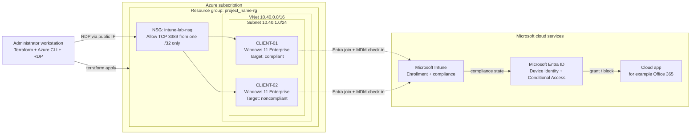

# Intune Compliance Lab on Azure

[](terraform/versions.tf)
[](terraform/versions.tf)
[](Set-Client02LabState.ps1)
[](docs/compliance-policies.md)
[](LICENSE)

A hands-on **Windows 11 lab on Azure** for learning **Microsoft Intune device compliance** and **Microsoft Entra Conditional Access**.

Terraform deploys two Windows 11 virtual machines. You enroll both in Intune, apply a compliance policy, then deliberately make one device noncompliant and watch Intune report it and Conditional Access react.

> [!IMPORTANT]
> Terraform automates the **Azure infrastructure only**. Entra join, Intune enrollment, compliance policies, and Conditional Access are **manual steps** that this README and the [step-by-step guides](docs/00-lab-overview.md) walk you through.

---

## Contents

1. [What this lab does](#what-this-lab-does)
2. [How it works](#how-it-works)
3. [Before you start](#before-you-start)
4. [Lab steps](#lab-steps)
   - [Step 1: Prepare your workstation](#step-1-prepare-your-workstation)
   - [Step 2: Deploy the Azure VMs](#step-2-deploy-the-azure-vms)
   - [Step 3: Enroll both VMs in Intune](#step-3-enroll-both-vms-in-intune)
   - [Step 4: Create the compliance policy](#step-4-create-the-compliance-policy)
   - [Step 5: Make CLIENT-02 noncompliant](#step-5-make-client-02-noncompliant)
   - [Step 6: Test Conditional Access (optional)](#step-6-test-conditional-access-optional)
   - [Step 7: Restore and clean up](#step-7-restore-and-clean-up)
5. [Expected results](#expected-results)
6. [Repository structure](#repository-structure)
7. [Documentation](#documentation)
8. [Troubleshooting](#troubleshooting)
9. [Contributing and license](#contributing-and-license)

---

## What this lab does

| Device | Role in the lab | Expected compliance |
|---|---|---|
| `CLIENT-01` | **Control device.** Left untouched. | Compliant |
| `CLIENT-02` | **Test device.** Firewall and Defender real-time protection are switched off for a short test with [`Set-Client02LabState.ps1`](Set-Client02LabState.ps1). | Not compliant, then compliant again after restore |

Comparing the two shows that a change in Intune's report is caused by the **device state**, not by the policy or the tenant.

**You will learn:**

- The difference between **configuration** (setting device state), **compliance** (checking it), **reporting**, and **enforcement** (Conditional Access).
- How Entra join and automatic MDM enrollment bring a Windows device under Intune management.
- How Intune evaluates Firewall, Antivirus, and real-time protection settings, and how check-in timing and Tamper Protection affect the results.
- How to roll out Conditional Access safely: Report-only mode, exclusions, and sign-in log review.
- Why Intune on Azure VMs has [documented limitations](docs/architecture.md#intune-on-azure-vms-limitations) compared with physical devices.

## How it works



1. **Terraform** creates the resource group, network, NSG, and two VMs (solid lines).
2. You **join** each VM to Microsoft Entra ID. Automatic enrollment registers it in **Intune** (dotted lines).
3. Intune **evaluates** each device against the compliance policy and writes the result to Entra ID.
4. **Conditional Access** reads that result when a user signs in to a cloud app from the device, and grants or blocks access.

| What | Implemented by | Where |
|---|---|---|
| Resource group, VNet, subnet, NSG, 2 VMs (Trusted Launch) | Terraform | [`terraform/`](terraform/) |
| RDP restricted to your `/32` (auto-detected or set) | Terraform | [`terraform/security.tf`](terraform/security.tf) |
| Deploy / destroy helpers | PowerShell | [`scripts/`](scripts/) |
| CLIENT-02 drift script (Status / Apply / Restore) | PowerShell | [`Set-Client02LabState.ps1`](Set-Client02LabState.ps1) |
| Entra join, Intune enrollment, compliance policy, Conditional Access | **Manual** | [Step-by-step guides](docs/00-lab-overview.md) |

Full details: [Architecture](docs/architecture.md).

## Before you start

| Area | You need |
|---|---|
| Azure | A subscription and **Contributor** rights; `Microsoft.Compute` and `Microsoft.Network` providers registered |
| Tools | [Terraform](https://developer.hashicorp.com/terraform/install) 1.6+, [Azure CLI](https://learn.microsoft.com/cli/azure/install-azure-cli), a Remote Desktop client |
| Licensing | Microsoft Intune Plan 1 and Microsoft Entra ID P1 for the test user (for example Microsoft 365 E3/E5); eligible Windows 11 Enterprise licensing |
| Accounts | A dedicated, licensed, **non-admin** test user, and an emergency access account to exclude from Conditional Access |
| Admin roles | Intune Administrator; Conditional Access Administrator for Step 6 |
| Network | Outbound HTTPS to `api.ipify.org` for RDP IP auto-detection, or your public IPv4 to set manually |

> [!WARNING]
> The lab creates **billable** Azure resources. Deallocate the VMs between sessions and destroy the lab when finished. See [Cost considerations](docs/prerequisites.md#cost-considerations).

Full details: [01 - Prerequisites](docs/01-prerequisites.md).

---

## Lab steps

Each step explains **what** you do and **why**, gives the key commands, and shows the result to expect. Follow the linked guide for full instructions.

### Step 1: Prepare your workstation

**Why:** Terraform deploys into whichever Azure subscription is active, so confirm it first.

```powershell
git clone https://github.com/emadadel2008/intune-compliance-lab.git
cd intune-compliance-lab\terraform

az login
az account set --subscription "YOUR_SUBSCRIPTION_ID"
az account show --output table
```

✅ **Expected:** `az account show` displays the subscription you intend to use.

📘 Guide: [01 - Prerequisites](docs/01-prerequisites.md)

### Step 2: Deploy the Azure VMs

**Why:** This creates the two Windows 11 devices you will manage. RDP is allowed only from your own public IP.

1. Create your private variables file. It is git-ignored.

   ```powershell
   Copy-Item .\terraform.tfvars.example .\terraform.tfvars
   notepad .\terraform.tfvars
   ```

   | Setting | What to put |
   |---|---|
   | `location` | Your Azure region (default `uaenorth`) |
   | `vm_size` | Optional; default `Standard_B2ms` |
   | `allowed_rdp_cidr` | Optional. Leave it out to auto-detect your public IP, or set `"YOUR_PUBLIC_IP/32"` |
   | `admin_password` | **Do not put it in the file.** Terraform prompts for it. |

2. Deploy:

   ```powershell
   terraform init
   terraform plan -out tfplan
   terraform apply tfplan
   terraform output
   ```

   Or run `..\scripts\deploy.ps1` for pre-flight checks and a plan, then `terraform apply`.

✅ **Expected:** `terraform output` shows both VM names, their public IPs, and `rdp_allowed_source` equal to your public IP `/32`. You can RDP to each VM as `.\labadmin`.

📘 Guide: [02 - Azure infrastructure](docs/02-azure-infrastructure.md) · Full walkthrough: [Setup guide](docs/setup-guide.md)

### Step 3: Enroll both VMs in Intune

**Why:** Intune can only evaluate devices it manages. Entra join gives each VM a cloud identity, and automatic enrollment makes Intune manage it.

1. **Once per tenant:** allow the test user to join devices, and set the **MDM user scope** to include the test user (Intune admin center → Devices → Windows → Enrollment → Automatic Enrollment).
2. **On each VM:** Settings → Accounts → Access work or school → **Connect** → **Join this device to Microsoft Entra ID** → sign in as `YOUR_TEST_USER` → restart.
3. **Verify** on each VM:

   ```powershell
   dsregcmd /status | Select-String "AzureAdJoined|MdmUrl"
   ```

✅ **Expected:** `AzureAdJoined : YES`, a non-empty `MdmUrl`, and both devices listed in Intune admin center → Devices → Windows.

📘 Guide: [03 - Intune enrollment](docs/03-intune-enrollment.md)

### Step 4: Create the compliance policy

**Why:** The policy defines what "healthy" means. Intune checks each device against it at every check-in.

1. Create a device group `GRP-IntuneLab-Devices` containing `CLIENT-01` and `CLIENT-02`.
2. Create a **Windows 10 and later** compliance policy `CP-Win-IntuneLab-Baseline`:

   | Setting | Value |
   |---|---|
   | Firewall | Require |
   | Antivirus, Antispyware | Require |
   | Real-time protection | Require |
   | Mark device noncompliant | Immediately |

3. Assign it to `GRP-IntuneLab-Devices`, then **Sync** each VM (Access work or school → Info → Sync).

✅ **Expected:** both devices show **Compliant**. This is your baseline.

📘 Guide: [04 - Compliance policy](docs/04-compliance-policy.md)

### Step 5: Make CLIENT-02 noncompliant

**Why:** Seeing a device fail, and recover, shows exactly how compliance evaluation works.

On `CLIENT-02`, in an **elevated** PowerShell:

```powershell
Set-ExecutionPolicy -Scope Process Bypass -Force
.\Set-Client02LabState.ps1 -Action Status    # current state
.\Set-Client02LabState.ps1 -Action Apply     # back up, then disable Firewall and Defender RTP
```

Then **Sync** the device and refresh its compliance in Intune.

✅ **Expected:** `CLIENT-02` becomes **Not compliant** on the **Firewall** setting. `CLIENT-01` stays Compliant.

> [!NOTE]
> Tamper Protection may block the Defender change. That is expected; do not bypass it. The Firewall setting is the reliable signal.

📘 Guide: [04 - Compliance policy](docs/04-compliance-policy.md#4-make-client-02-noncompliant) · Script reference: [CLIENT-02 lab script](docs/client02-lab-script.md)

### Step 6: Test Conditional Access (optional)

**Why:** Compliance becomes meaningful when it controls access. Report-only mode shows what *would* happen without blocking anyone.

1. Create a Conditional Access policy `CA-IntuneLab-RequireCompliantDevice-ReportOnly`:
   - **Users:** include `YOUR_TEST_USER`; **exclude** emergency access accounts and your admin account.
   - **Target resources:** Office 365.
   - **Grant:** Require device to be marked as compliant.
   - **Enable policy:** **Report-only**.
2. From each VM, sign in to `https://www.office.com` in Microsoft Edge as `YOUR_TEST_USER`.
3. Review **Entra admin center → Sign-in logs → Report-only** tab.

✅ **Expected:** `CLIENT-01` shows *Report-only: Success*; `CLIENT-02` shows *Report-only: Failure*.

> [!WARNING]
> Never start in **On** mode. A misconfigured policy can lock you out of the tenant.

📘 Guide: [05 - Conditional Access](docs/05-conditional-access.md)

### Step 7: Restore and clean up

**Why:** CLIENT-02 should not stay unprotected, and lab resources cost money while they exist.

1. On `CLIENT-02`: `.\Set-Client02LabState.ps1 -Action Restore`, then sync. It should return to **Compliant**.
2. Delete the Conditional Access policy, the compliance policy, the lab devices in Intune and Entra ID (**Delete**, never **Wipe**), and the lab group.
3. Destroy the Azure resources from the `terraform` folder:

   ```powershell
   ..\scripts\destroy.ps1      # type DESTROY to confirm
   az group exists --name intune-lab-rg
   ```

✅ **Expected:** `az group exists` returns `false`.

📘 Guide: [07 - Cleanup](docs/07-cleanup.md)

---

## Expected results

| Device | Device state | Intune compliance | Conditional Access (Report-only) |
|---|---|---|---|
| `CLIENT-01` | Firewall on, Defender RTP on | Compliant | Success (would grant) |
| `CLIENT-02` after `Apply` | Firewall off; RTP off unless blocked by Tamper Protection | Not compliant | Failure (would block) |
| `CLIENT-02` after `Restore` | Original settings | Compliant after next check-in | Success (would grant) |

These are **expected** results. Actual results depend on your tenant settings, Windows build, and check-in timing. Record yours with the [evidence log template](docs/validation-and-testing.md#evidence-log-template).

## Repository structure

```text
intune-compliance-lab/
├── README.md                      # This page
├── CHANGELOG.md                   # Notable changes
├── CONTRIBUTING.md                # Contribution and repository hygiene rules
├── LICENSE                        # MIT
├── Set-Client02LabState.ps1       # Runs inside CLIENT-02: Status / Apply / Restore
├── docs/
│   ├── 00-lab-overview.md … 07-cleanup.md   # Step-by-step guides
│   ├── index.md                   # Documentation home and reference pages
│   └── images/                    # Screenshot capture list
├── scripts/
│   ├── deploy.ps1                 # Pre-flight: tool checks, init, fmt, validate, plan
│   └── destroy.ps1                # Destroy with typed confirmation
└── terraform/
    ├── versions.tf                # Terraform and provider constraints
    ├── providers.tf               # azurerm provider configuration
    ├── variables.tf               # Inputs and validation rules
    ├── main.tf                    # Resource group, VNet, subnet
    ├── security.tf                # NSG, RDP rule, public IP detection
    ├── virtual-machines.tf        # Public IPs, NICs, Windows 11 VMs
    ├── outputs.tf                 # RG name, VM names, public IPs, username, RDP source
    ├── terraform.tfvars.example   # Safe placeholder values
    └── .terraform.lock.hcl        # Provider version lock
```

## Documentation

**Step-by-step guides** (follow in order):

| Step | Guide | Covers |
|---|---|---|
| 00 | [Lab overview](docs/00-lab-overview.md) | Objectives, environment, workflow |
| 01 | [Prerequisites](docs/01-prerequisites.md) | Licensing, roles, accounts, tools |
| 02 | [Azure infrastructure](docs/02-azure-infrastructure.md) | Deploy and verify the VMs |
| 03 | [Intune enrollment](docs/03-intune-enrollment.md) | Automatic enrollment and Entra join |
| 04 | [Compliance policy](docs/04-compliance-policy.md) | Group, policy, evaluation, drift |
| 05 | [Conditional Access](docs/05-conditional-access.md) | Report-only testing and enforcement |
| 06 | [Validation and troubleshooting](docs/06-validation-and-troubleshooting.md) | Commands and common issues |
| 07 | [Cleanup](docs/07-cleanup.md) | Restore and remove everything |

**Reference pages:**

| Page | Description |
|---|---|
| [Documentation home](docs/index.md) | Learning path and document map |
| [Architecture](docs/architecture.md) | Topology, design decisions, VM limitations |
| [Setup guide](docs/setup-guide.md) | Detailed Terraform deployment and teardown |
| [Device enrollment](docs/device-enrollment.md) | Join vs. enrollment, sequence, validation |
| [Compliance policies](docs/compliance-policies.md) | Policy design, evaluation, state lifecycle |
| [Conditional Access](docs/conditional-access.md) | Decision flow, testing, enforcement |
| [Lab scenarios](docs/lab-scenarios.md) | Guided exercises with durations |
| [Validation and testing](docs/validation-and-testing.md) | Evidence to collect at each stage |
| [Security considerations](docs/security-considerations.md) | Threat model and safe operation |
| [FAQ](docs/faq.md) · [Glossary](docs/glossary.md) | Quick answers and terminology |

## Troubleshooting

| Problem | Quick fix |
|---|---|
| RDP blocked: portal shows `DefaultRule_DenyAllInBound` | Your IP changed. Run `terraform apply`, or update `allowed_rdp_cidr` |
| `allowed_rdp_cidr is still an example documentation address` | Replace `203.0.113.10/32` with your real IP, or remove the line |
| Device in Entra ID but not in Intune | Add the test user to the MDM user scope, then re-join |
| CLIENT-02 still Compliant after `Apply` | Sync the device and wait a few minutes |

More: [06 - Validation and troubleshooting](docs/06-validation-and-troubleshooting.md) and [Troubleshooting](docs/troubleshooting.md). When opening an issue, **never** include tenant IDs, subscription IDs, public IPs, or credentials.

## Contributing and license

Contributions are welcome. See [CONTRIBUTING.md](CONTRIBUTING.md) for the workflow, validation commands, and hygiene rules. Released under the [MIT License](LICENSE).

> [!NOTE]
> This is a community training lab, not a production reference architecture. Validate licensing, regional availability, security, and current Microsoft product behavior before use.
