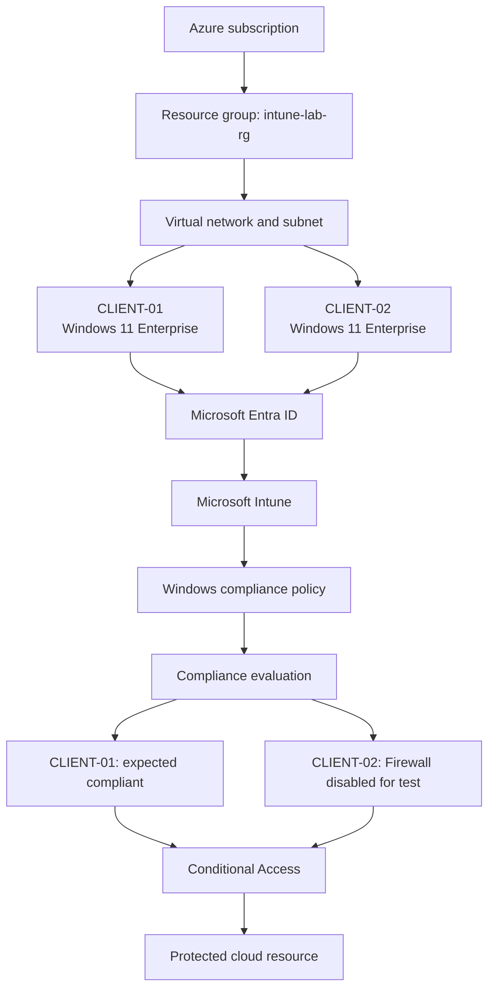
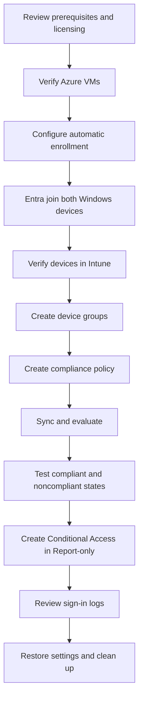

# Microsoft Intune Compliance and Conditional Access Lab

[← Documentation home](index.md) · Next: [01 - Prerequisites](01-prerequisites.md)

A hands-on lab using two Windows 11 Azure virtual machines to demonstrate Microsoft Entra join, Intune MDM enrollment, device compliance, and Conditional Access.

The numbered guides `01`–`07` are a linear, step-by-step path through the lab. Each guide links to the detailed reference pages in this folder for background and deeper explanations.

## Lab objective

Enroll two Windows 11 devices into Microsoft Intune, apply a Windows compliance policy, create one compliant and one noncompliant test state, and observe how Microsoft Entra Conditional Access evaluates access to a protected cloud resource.

## Environment

| Component | Configuration |
|---|---|
| Cloud | Microsoft Azure |
| Region | UAE North (`uaenorth`, default `location`) |
| Resource group | `intune-lab-rg` (`<project_name>-rg`) |
| Virtual machines | `CLIENT-01`, `CLIENT-02` |
| Operating system | Windows 11 Enterprise (`win11-24h2-ent`) |
| VM size | `Standard_B2ms` by default; set `vm_size` in `terraform.tfvars` to change it, for example `Standard_D2as_v7` |
| Device join | Microsoft Entra joined |
| Device management | Microsoft Intune |
| Access control | Microsoft Entra Conditional Access |
| VM access | Direct RDP restricted to one `/32`; not Azure Virtual Desktop |

## Learning outcomes

1. Explain the relationship between Microsoft Entra join, Intune enrollment, and compliance.
2. Configure Windows automatic MDM enrollment.
3. Enroll and verify two Windows devices.
4. Create and assign a Windows compliance policy.
5. Compare a compliant baseline with a device that fails a compliance requirement.
6. Configure Conditional Access to require a compliant device.
7. Validate safely in Report-only mode.
8. Restore the test device and clean up resources.

## Architecture



Terraform creates only the Azure part of this diagram (subscription down to the VMs). Everything from Microsoft Entra ID onward is configured manually by following the guides. See [Architecture](architecture.md) for the full resource inventory.

## Workflow



## Repository layout

```text
intune-compliance-lab/
├── README.md
├── Set-Client02LabState.ps1        # CLIENT-02 drift script (repository root)
├── terraform/                      # Azure infrastructure
├── scripts/
│   ├── deploy.ps1
│   └── destroy.ps1
└── docs/
    ├── 00-lab-overview.md          # this page
    ├── 01-prerequisites.md
    ├── 02-azure-infrastructure.md
    ├── 03-intune-enrollment.md
    ├── 04-compliance-policy.md
    ├── 05-conditional-access.md
    ├── 06-validation-and-troubleshooting.md
    ├── 07-cleanup.md
    ├── images/                     # screenshots (see images/README.md)
    └── ...                         # detailed reference pages
```

## Safety and repository hygiene

- This is a lab, not a production security baseline.
- Use a dedicated test user with appropriate Intune and Entra licensing. Do not use a Global Administrator for routine device sign-in.
- RDP is restricted to a single trusted source IP (`/32`) by the NSG. Do not expose TCP/3389 to the entire Internet. See [Security considerations](security-considerations.md).
- CLIENT-02's Firewall is disabled only for a short controlled test. Restore the original settings immediately afterward.
- Tamper Protection may prevent local Defender changes. Do not bypass it.
- A local setting change does not guarantee noncompliance; the authoritative result is Intune's per-setting evaluation.
- Never commit passwords, Terraform state, secret-bearing `.tfvars`, tenant IDs, subscription IDs, public IPs, private keys, or sensitive screenshots.

## Guides

| Guide | Content |
|---|---|
| [01 - Prerequisites](01-prerequisites.md) | Licensing, roles, accounts, preparation |
| [02 - Azure infrastructure](02-azure-infrastructure.md) | Deploy and verify Terraform resources and network |
| [03 - Intune enrollment](03-intune-enrollment.md) | Configure automatic enrollment and join devices |
| [04 - Compliance policy](04-compliance-policy.md) | Groups, policy, assignments, evaluation |
| [05 - Conditional Access](05-conditional-access.md) | Report-only testing and enforcement |
| [06 - Validation and troubleshooting](06-validation-and-troubleshooting.md) | Commands and common issues |
| [07 - Cleanup](07-cleanup.md) | Restore security and remove resources |

## Microsoft Learn references

- [Windows automatic enrollment](https://learn.microsoft.com/en-us/intune/intune-service/enrollment/windows-enroll)
- [Windows enrollment guide](https://learn.microsoft.com/en-us/intune/intune-service/fundamentals/deployment-guide-enrollment-windows)
- [Windows compliance settings](https://learn.microsoft.com/en-us/intune/device-security/compliance/ref-windows-settings)
- [Sync a device in Intune](https://learn.microsoft.com/en-us/intune/device-management/actions/sync)
- [Require device compliance with Conditional Access](https://learn.microsoft.com/en-us/entra/identity/conditional-access/policy-all-users-device-compliance)
