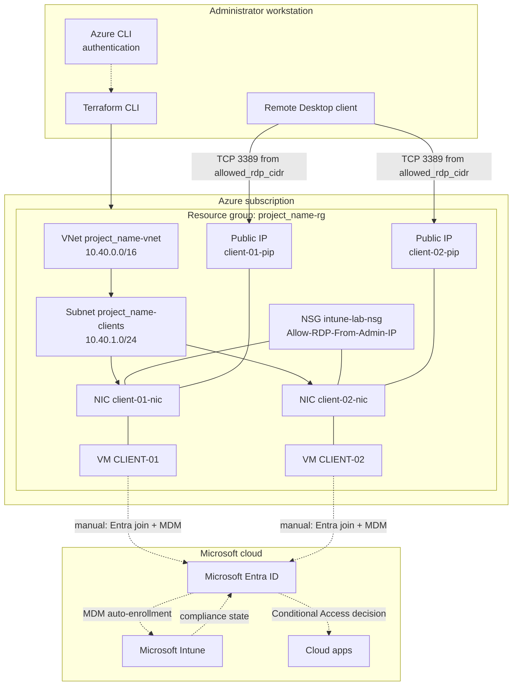
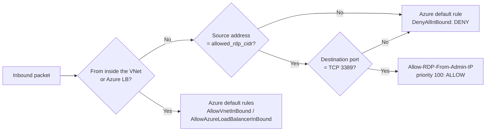
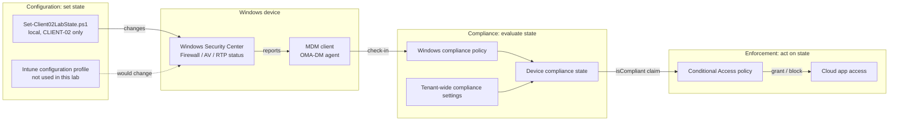

# Architecture

[← Documentation home](index.md)

This page describes what the lab deploys, how the pieces relate, and the design decisions behind them. Everything in the **Azure resources** section is implemented in [`terraform/`](../terraform/). Everything in the **Identity and management layer** section is configured manually after deployment.

## Contents

- [High-level solution architecture](#high-level-solution-architecture)
- [Azure resources](#azure-resources)
- [Network security](#network-security)
- [Virtual machine configuration](#virtual-machine-configuration)
- [Identity and management layer](#identity-and-management-layer)
- [Component relationships](#component-relationships)
- [Device roles for the exercise](#device-roles-for-the-exercise)
- [Intune on Azure VMs: limitations](#intune-on-azure-vms-limitations)
- [Design decisions](#design-decisions)
- [Known gaps](#known-gaps)

## High-level solution architecture

**How to read this diagram:** Solid arrows are Azure resources and relationships created by Terraform. Dotted arrows are identity and management relationships you configure manually after deployment. Terraform has no knowledge of Entra ID or Intune.

## Azure resources

Resource names are derived from `var.project_name` (default `intune-lab`). One exception: the NSG name is fixed as `intune-lab-nsg`.

| Terraform resource | Azure name (defaults) | File | Purpose |
|---|---|---|---|
| `azurerm_resource_group.lab` | `intune-lab-rg` | `main.tf` | Container for all lab resources; tagged `project`, `environment=training`, `managed_by=terraform` |
| `azurerm_virtual_network.lab` | `intune-lab-vnet` | `main.tf` | Address space `var.address_space` (default `10.40.0.0/16`) |
| `azurerm_subnet.clients` | `intune-lab-clients` | `main.tf` | Prefix `var.subnet_prefix` (default `10.40.1.0/24`) |
| `azurerm_network_security_group.lab` | `intune-lab-nsg` | `security.tf` | Inbound filtering for both VMs |
| `azurerm_network_security_rule.allow_rdp` | `Allow-RDP-From-Admin-IP` | `security.tf` | Allow TCP 3389 from `local.rdp_source_cidr` only (pinned `allowed_rdp_cidr` or the auto-detected `/32`), priority 100 |
| `azurerm_network_interface_security_group_association.clients` | (association) | `security.tf` | Attaches the NSG to **each NIC** |
| `azurerm_public_ip.clients` ×2 | `intune-lab-client-0N-pip` | `virtual-machines.tf` | Static, Standard SKU public IPv4 |
| `azurerm_network_interface.clients` ×2 | `intune-lab-client-0N-nic` | `virtual-machines.tf` | Dynamic private IP in the subnet, bound to the public IP |
| `azurerm_windows_virtual_machine.clients` ×2 | `CLIENT-01`, `CLIENT-02` | `virtual-machines.tf` | Windows 11 Enterprise VMs |

Outputs (from [`outputs.tf`](../terraform/outputs.tf)): `resource_group_name`, `vm_names`, `public_ips`, `rdp_username`.

## Network security

- The only custom inbound rule allows **TCP 3389** from a single IPv4 `/32`: `allowed_rdp_cidr` if set, otherwise the public IP of the machine running Terraform, detected by `data.http.admin_public_ip`. Validation in [`variables.tf`](../terraform/variables.tf) rejects anything that is not a valid `/32`, and rejects RFC 5737 documentation addresses.
- Azure's default NSG rules remain in effect. They allow traffic from within the VNet and from the Azure load balancer, allow all outbound traffic, and deny all other inbound traffic.
- The NSG is associated with each **network interface**, not with the subnet.
- Outbound Internet access is required. The VMs must reach Microsoft Entra ID, Intune, Windows Update, and Defender update endpoints.

> [!NOTE]
> Before the fix recorded in [CHANGELOG.md](../CHANGELOG.md), the RDP rule used `source_address_prefix = "*"`. That opened RDP to the entire Internet and left `allowed_rdp_cidr` unused. If you deployed an earlier version, run `terraform apply` again to replace the rule.

## Virtual machine configuration

| Setting | Value | Why |
|---|---|---|
| Image | `MicrosoftWindowsDesktop` / `Windows-11` / `win11-24h2-ent` / `latest` | Windows 11 Enterprise is the edition Intune supports on VMs |
| Size | `Standard_B2ms` (default) | Low cost; supports Trusted Launch. Override with `vm_size`. |
| Secure Boot | Enabled | Windows 11 requirement; Trusted Launch |
| vTPM | Enabled | Windows 11 requirement; Trusted Launch |
| OS disk | `StandardSSD_LRS`, `ReadWrite` caching | Balanced cost/performance |
| `license_type` | `Windows_Client` (default) | Declares eligible Windows client licensing; set only if eligible |
| Boot diagnostics | Enabled (managed storage) | Serial console and screenshot for troubleshooting |
| Managed identity | System-assigned | Created but **not used** by any other resource in this repository |
| Admin account | `var.admin_username` (default `labadmin`) / `var.admin_password` (sensitive, ≥ 12 chars) | Local administrator for RDP and in-guest tasks |

Trusted Launch reference: [Trusted Launch for Azure VMs](https://learn.microsoft.com/azure/virtual-machines/trusted-launch).

## Identity and management layer

None of these components are deployed by Terraform. They are tenant-level objects you create in the Microsoft Entra admin center and the Microsoft Intune admin center.

| Component | Plane | Role in this lab | Doc |
|---|---|---|---|
| Entra device object | Identity | Created when each VM is Entra-joined | [Device enrollment](device-enrollment.md) |
| MDM automatic enrollment (MDM user scope) | Identity → Management | Enrolls the device in Intune during Entra join | [Device enrollment](device-enrollment.md) |
| Intune managed device | Management | Represents the enrolled VM; holds compliance state | [Device enrollment](device-enrollment.md) |
| Entra security group (for example `GRP-IntuneLab-Devices`) | Identity | Assignment target for the compliance policy | [Compliance policies](compliance-policies.md) |
| Windows compliance policy | Management (evaluation) | Defines "healthy": Firewall, AV, RTP | [Compliance policies](compliance-policies.md) |
| Conditional Access policy | Identity (enforcement) | Optional: grants access only from compliant devices | [Conditional Access](conditional-access.md) |

## Component relationships

This diagram shows the most important concept in the lab. **Configuration**, **compliance evaluation**, and **enforcement** are different stages:

1. **Configuration** changes the device. In this lab, `Set-Client02LabState.ps1` does it locally. In production, an Intune configuration profile or security policy normally does it.
2. **Compliance evaluation** only **checks** the device against rules and produces a state. A compliance policy does not turn the firewall on.
3. **Enforcement** happens elsewhere. Conditional Access reads the compliance state from Entra ID and decides whether a sign-in is allowed.

## Device roles for the exercise

| VM | Teaching role | How the role is achieved |
|---|---|---|
| `CLIENT-01` | Reference **compliant** device | Leave Windows Firewall and Defender at their defaults (on) |
| `CLIENT-02` | Deliberately **noncompliant** device | Run `Set-Client02LabState.ps1 -Action Apply`, then later `-Action Restore` |

These roles are conventions, **not** something Terraform enforces. Both VMs are deployed identically. Only the tag `lab_device` differs: `client-01` or `client-02`. Compliance is decided by Intune after enrollment and check-in.

## Intune on Azure VMs: limitations

Microsoft documents specific limitations for Windows VMs managed by Intune. See [Using Windows virtual machines with Intune](https://learn.microsoft.com/intune/solutions/windows-virtual-machines). The ones relevant to this lab:

| Limitation | Impact on this lab |
|---|---|
| Windows Autopilot, Commercial OOBE, and the Enrollment Status Page are not supported on VMs accessible only through RDP | Enroll with Entra join from **Settings** after first sign-in, not through OOBE |
| Configurations that use TPM or hardware management (BitLocker settings, DFCI) are not supported | Do not use BitLocker-based compliance rules for the lab result |
| Do not use **Wipe** on a VM reachable only through RDP | Wipe removes RDP settings, and you lose access permanently |
| Cloned images of an enrolled device are not supported | Never capture or clone a VM after enrollment |
| Deallocated VMs cannot check in | Stopped VMs can show as stale or noncompliant |
| Intune reports the model as **Virtual Machine** | Expected; use it to confirm the VM is detected |
| Deleting VMs leaves orphaned Intune records until device cleanup rules remove them | Delete device records manually during [cleanup](lab-scenarios.md#scenario-6-cleanup) |

## Design decisions

| Decision | Rationale | Trade-off |
|---|---|---|
| Standalone VMs, not Azure Virtual Desktop | Simplest way to get persistent, single-user Windows Enterprise devices | No AVD-specific features; RDP is direct over a public IP |
| Public IP + NSG restricted to one `/32` | No extra cost and easy for a lab | Exposes RDP to one address; [Azure Bastion](https://learn.microsoft.com/azure/bastion/bastion-overview) is safer but costs more |
| In-guest Entra join, no `AADLoginForWindows` extension | Mirrors user-driven enrollment on a real PC | Entra-account RDP needs extra steps; the local admin is used for RDP |
| Local script creates drift instead of an Intune profile | Shows that compliance **detects** drift regardless of how it happened | Does not demonstrate configuration profile deployment |
| Admin password passed as a sensitive variable | No secrets in the repository | The value is still stored in plain text in Terraform state |
| Local Terraform state | No backend to set up | State and the password stay on your workstation; protect it |

## Known gaps

These are observations from the repository contents, not implemented features:

- The `hashicorp/http` provider is used only for public IP auto-detection; it makes an outbound HTTPS call to `api.ipify.org` when `allowed_rdp_cidr` is unset.
- The VMs' system-assigned managed identities are not referenced by any role assignment or extension.
- The NSG name is hard-coded (`intune-lab-nsg`) and does not follow `project_name`.
- No Intune or Entra objects (policies, groups, CA) are defined as code. See [Lab scenarios](lab-scenarios.md) for manual steps and [CONTRIBUTING.md](../CONTRIBUTING.md) for suggested improvements.
