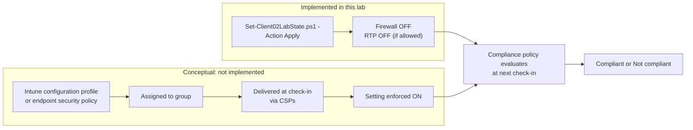
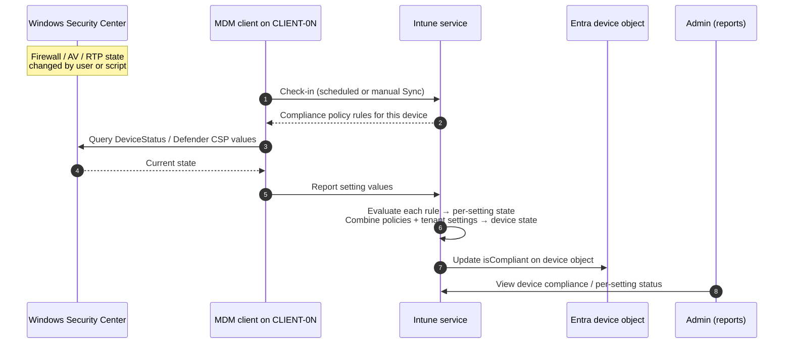
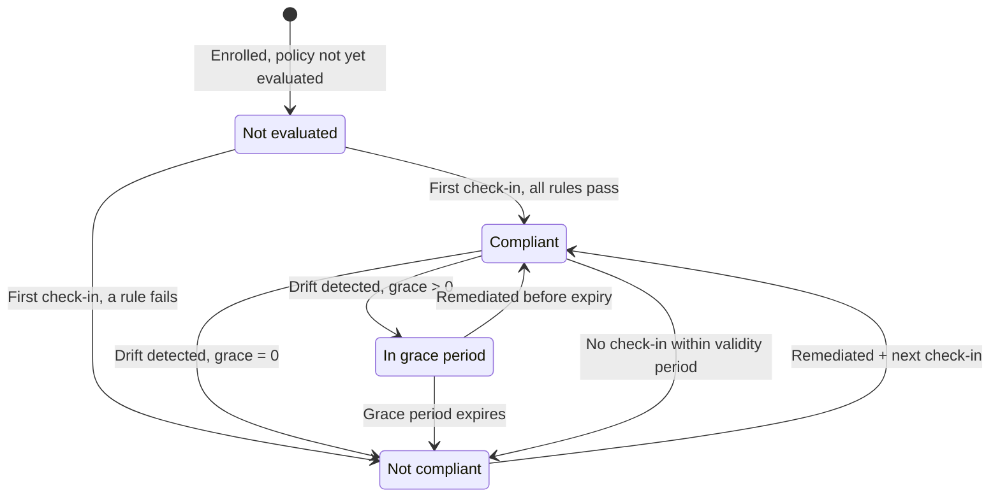

# Compliance policies

[← Documentation home](index.md)

This page covers the core of the lab: what a Windows compliance policy is, how Intune evaluates it, which settings to use on Azure VMs, and how compliance state changes over time. **The compliance policy is created manually.** The repository does not contain policy definitions.

## Contents

- [Configuration, compliance, reporting, enforcement](#configuration-compliance-reporting-enforcement)
- [How configuration profiles relate to this lab](#how-configuration-profiles-relate-to-this-lab)
- [Recommended lab policy](#recommended-lab-policy)
- [Settings to avoid on Azure VMs](#settings-to-avoid-on-azure-vms)
- [Create and assign the policy](#create-and-assign-the-policy)
- [Tenant-wide compliance settings](#tenant-wide-compliance-settings)
- [How compliance is evaluated](#how-compliance-is-evaluated)
- [Compliance state lifecycle](#compliance-state-lifecycle)
- [Check-in timing](#check-in-timing)
- [Validate](#validate)
- [Common errors](#common-errors)
- [Security implications](#security-implications)
- [References](#references)

## Configuration, compliance, reporting, enforcement

Intune features are often described interchangeably, but they do different jobs:

| Concept | Question it answers | Changes the device? | In this lab |
|---|---|---|---|
| **Device configuration** | "What should this setting be?" | **Yes**: writes settings through configuration service providers (CSPs) | Done locally by `Set-Client02LabState.ps1` |
| **Configuration profile** | The Intune object that delivers device configuration | **Yes** | Not used |
| **Endpoint security policy** (for example, Firewall or Antivirus) | Focused configuration for security settings | **Yes** | Not used |
| **Device compliance** | "Is this device healthy enough?" | No | Core topic |
| **Compliance policy** | The Intune object that defines the rules for "healthy" | **No**: it only evaluates | Created manually |
| **Compliance evaluation** | The process of comparing reported device state with rules | No | Happens at each check-in |
| **Compliance reporting** | Where you see results | No | Intune admin center reports |
| **Enforcement** | "Should this sign-in be allowed?" | No (it gates access) | Conditional Access ([optional](conditional-access.md)) |
| **App protection policy** | Protecting data inside apps (MAM) | No | Not relevant to this lab |

> [!IMPORTANT]
> Setting **Firewall: Require** in a compliance policy does **not** turn the firewall on. It only marks the device **Not compliant** when the firewall is off. To *keep* a setting on, use a configuration profile or endpoint security policy. To *act* on noncompliance, use Conditional Access or actions for noncompliance.

## How configuration profiles relate to this lab

The lab intentionally creates drift **outside** Intune, so you can watch compliance **detect** it. The diagram below compares the two paths. The configuration-profile path is **conceptual** and not implemented in this repository.



If you later add a Firewall endpoint security policy that forces the firewall **on**, it will compete with the script. The result then depends on which change applied last. Do not combine them in this exercise.

## Recommended lab policy

A **Windows 10 and later** compliance policy that uses Windows Security Center–reported settings. These work on VMs and are directly affected by `Set-Client02LabState.ps1`.

**Suggested name:** `CP-Win-IntuneLab-Baseline`

| Section | Setting | Value | Affected by `Apply`? | Expected on CLIENT-02 after `Apply` |
|---|---|---|---|---|
| System Security → Device Security | **Firewall** | Require | **Yes**: all profiles disabled | Not compliant |
| System Security → Device Security | **Antivirus** | Require | Possibly | Depends on how Windows Security Center reports AV status with RTP off |
| System Security → Device Security | **Antispyware** | Require | Possibly | Same as above |
| System Security → Defender | **Microsoft Defender Antimalware** | Require | Unlikely (service is not stopped) | Likely compliant |
| System Security → Defender | **Real-time protection** | Require | **Yes**, if Tamper Protection does not block it | Not compliant if RTP was actually disabled |
| System Security → Defender | **Microsoft Defender Antimalware security intelligence up-to-date** | Require (optional) | No | Depends on update state; can cause **unexpected** noncompliance on a fresh VM |
| Actions for noncompliance | **Mark device noncompliant** | Immediately (0 days) | n/a | No grace period, so results show quickly |

**Why Firewall is the primary signal:** The script reliably turns off all three firewall profiles. Defender changes can be blocked by **Tamper Protection**, which is on by default on many Windows 11 builds. The **Firewall** rule is therefore the most deterministic way to produce a noncompliant result.

> [!NOTE]
> The "Expected" column is a prediction based on documented setting behavior, not a recorded test result. Record your actual results with [Validation and testing](validation-and-testing.md).

## Settings to avoid on Azure VMs

| Setting | Why to avoid in this lab |
|---|---|
| Require BitLocker / Encryption of data storage | Microsoft does not support TPM-dependent and BitLocker configuration on Intune-managed VMs |
| Require Secure Boot / Require code integrity (Device Health Attestation) | Attestation on virtual TPMs may not behave like physical devices; results can be misleading |
| Trusted Platform Module (TPM) | Same reason; outside the lab's learning goal |
| Password requirements | Can lock you out of the local admin RDP workflow or cause confusing results |
| Minimum OS version set too high | Fresh Marketplace images may be behind on updates and fail unexpectedly |
| Microsoft Defender for Endpoint machine risk score | Requires Defender for Endpoint onboarding, which this lab does not include |

Reference: [Using Windows virtual machines with Intune](https://learn.microsoft.com/intune/solutions/windows-virtual-machines).

## Create and assign the policy

**Required role:** Intune Administrator, or the Intune RBAC role *Policy and Profile Manager*.

1. Intune admin center → **Devices → Compliance → Create policy**.
2. **Platform:** Windows 10 and later → **Create**.
3. **Basics:** Name `CP-Win-IntuneLab-Baseline`, with a description.
4. **Compliance settings:** Configure the settings from the [recommended table](#recommended-lab-policy). Leave everything else **Not configured**.
5. **Actions for noncompliance:** Keep *Mark device noncompliant* = **Immediately**.
6. **Assignments:** **Include** `GRP-IntuneLab-Devices` (the device group from [Device enrollment](device-enrollment.md#prepare-the-tenant)).
7. **Review + create.**

> [!TIP]
> Assign to a **device** group, not a user group. Device-targeted compliance is evaluated for the device regardless of who is signed in. That matters here because you RDP as the local administrator.

> [!NOTE]
> **Screenshot placeholder, Figure 3:** The policy's *Compliance settings* summary, showing Firewall, Antivirus, Antispyware, and Real-time protection set to Require.

### Optional: create the policy with Microsoft Graph

This is an **illustrative** request body for `POST https://graph.microsoft.com/v1.0/deviceManagement/deviceCompliancePolicies`. It has **not** been executed as part of this repository. Review it against the [windows10CompliancePolicy resource](https://learn.microsoft.com/graph/api/resources/intune-deviceconfig-windows10compliancepolicy) before use. Required permission: `DeviceManagementConfiguration.ReadWrite.All`.

```json
{
  "@odata.type": "#microsoft.graph.windows10CompliancePolicy",
  "displayName": "CP-Win-IntuneLab-Baseline",
  "description": "Intune Compliance Lab: Firewall and Defender checks",
  "firewallEnabled": true,
  "antivirusRequired": true,
  "antiSpywareRequired": true,
  "defenderEnabled": true,
  "rtpEnabled": true,
  "scheduledActionsForRule": [
    {
      "ruleName": "PasswordRequired",
      "scheduledActionConfigurations": [
        {
          "actionType": "block",
          "gracePeriodHours": 0,
          "notificationTemplateId": "",
          "notificationMessageCCList": []
        }
      ]
    }
  ]
}
```

`scheduledActionsForRule` with `actionType: block` and `gracePeriodHours: 0` is the Graph equivalent of *Mark device noncompliant: Immediately*. The rule name is a fixed identifier required by the API, not a password rule. Assign the policy with the `assign` action, or in the portal.

## Tenant-wide compliance settings

Intune admin center → **Devices → Compliance → Compliance settings** (also reachable from **Endpoint security → Device compliance**). These settings apply to every device in the tenant:

| Setting | Default | Effect in the lab |
|---|---|---|
| Mark devices with no compliance policy assigned as | Compliant | If the device is not in the assigned group, it may show **Compliant** even though nothing was evaluated. Changing it to Not compliant affects the **whole tenant**. |
| Compliance status validity period (days) | 30 | A device that does not check in within this period becomes **Not compliant**. Long-deallocated VMs can hit this. |

## How compliance is evaluated



**Explanation:**

- Evaluation happens when the device **checks in**, not at the moment a setting changes. A device can be noncompliant in reality but still show **Compliant** until its next check-in.
- Each setting gets its own state, and the device state is the **worst** result across all assigned policies.
- Intune writes the result to the Entra device object. That is how Conditional Access sees it.

## Compliance state lifecycle



In this lab, the grace period is 0, so **In grace period** is not expected. Intune may also report **Error** or **Conflict** for individual settings, for example when a device syncs immediately after a reboot. See [Troubleshooting](troubleshooting.md#compliance-evaluation).

| Lab step | CLIENT-01 | CLIENT-02 |
|---|---|---|
| After enrollment, before policy | Not evaluated / tenant default | Not evaluated / tenant default |
| After policy assignment + sync | Compliant (expected) | Compliant (expected) |
| After `Apply` + sync | Compliant | **Not compliant** (expected) |
| After `Restore` + sync | Compliant | Compliant (expected) |

## Check-in timing

| Phase | Approximate Windows MDM check-in interval |
|---|---|
| Just after enrollment | Every 3 minutes for 15 minutes, then every 15 minutes for 2 hours |
| Steady state | About every 8 hours |
| On demand | Intune admin center → device → **Sync**, or on the device: **Access work or school → Info → Sync** |

Reporting in the admin center can lag behind evaluation by several minutes. Reference: [Policy refresh intervals](https://learn.microsoft.com/mem/intune/configuration/device-profile-troubleshoot#policy-refresh-intervals).

## Validate

- Device → **Device compliance** tab: lists each policy and its state. Select the policy to see **per-setting** results.
- **Devices → Monitor → Noncompliant devices** and the policy's **Device status** view.
- Microsoft Graph: see [Validation and testing](validation-and-testing.md#stage-4-compliance-evaluation).

## Common errors

| Symptom | Likely cause |
|---|---|
| Device shows **Compliant** but the firewall is off | No check-in since the change. **Sync** and wait. |
| Policy state **Not applicable** | Policy assigned to a user group but the device has no matching user, or a platform mismatch |
| Firewall setting shows **Error** | Sync immediately after reboot or resume. Sync again later. |
| Unexpectedly noncompliant on CLIENT-01 | Security intelligence out of date, a strict OS version rule, or the validity period was exceeded while deallocated |
| RTP rule still **Compliant** after `Apply` | Tamper Protection blocked the change. Check `RealTimeProtectionEnabled` with `-Action Status`. |

More: [Troubleshooting → Compliance evaluation](troubleshooting.md#compliance-evaluation).

## Security implications

- A compliance policy alone protects nothing. Without Conditional Access or other enforcement, a noncompliant device keeps full access.
- Setting "Mark devices with no compliance policy assigned as **Not compliant**" is safer in production, but it is tenant-wide. Change it only in a dedicated lab tenant.
- Prefer device groups that include only lab VMs, to avoid affecting real devices.

## References

- [Windows compliance settings reference](https://learn.microsoft.com/intune/device-security/compliance/ref-windows-settings)
- [Device compliance overview](https://learn.microsoft.com/mem/intune/protect/device-compliance-get-started)
- [Monitor compliance policies](https://learn.microsoft.com/mem/intune/protect/compliance-policy-monitor)
- [Actions for noncompliance](https://learn.microsoft.com/mem/intune/protect/actions-for-noncompliance)
