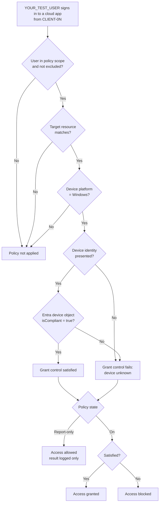

# Conditional Access (optional)

[← Documentation home](index.md)

Conditional Access (CA) is the **enforcement** stage of the lab. It reads the compliance state that Intune writes to the Entra device object, then grants or blocks access to cloud apps. **This is optional and manual.** No CA policy is defined in the repository.

> [!WARNING]
> Conditional Access is tenant-wide and can lock out users, including administrators. Always start in **Report-only** mode, scope the policy to a **dedicated test user**, and **exclude emergency access accounts**.

## Contents

- [What CA does and does not control in this lab](#what-ca-does-and-does-not-control-in-this-lab)
- [Decision flow](#decision-flow)
- [Prerequisites](#prerequisites)
- [Create the policy (Report-only)](#create-the-policy-report-only)
- [Test from each device](#test-from-each-device)
- [Read the results](#read-the-results)
- [Moving to enforcement](#moving-to-enforcement)
- [Common errors](#common-errors)
- [Security implications](#security-implications)
- [References](#references)

## What CA does and does not control in this lab

| Scenario | Governed by the CA policy in this guide? |
|---|---|
| Test user signs in to a cloud app (for example, Office 365 on the web) **from** `CLIENT-01` or `CLIENT-02` | **Yes** |
| You RDP to the VM's public IP as `.\labadmin` | **No.** This is a local Windows logon, not an Entra sign-in. |
| You RDP using the Entra account | Not by this policy. RDP to Entra-joined machines uses separate resources and flows. |
| Access from your own workstation | Only if your workstation's user is in scope (it should not be) |

The lab tests **"may this device reach a cloud app?"** It does not test **"may I reach this VM?"**

## Decision flow

**Explanation:** CA evaluates *who*, *what app*, and *which conditions* first, then checks the grant control. *Require device to be marked as compliant* needs two things: the client must present the device's identity, and the Entra device object must have `isCompliant = true`, as set by Intune. In **Report-only**, the outcome is recorded but never enforced.

## Prerequisites

| Requirement | Detail |
|---|---|
| License | Microsoft Entra ID P1 for the test user |
| Role | Conditional Access Administrator or Security Administrator |
| Devices | Both VMs enrolled and evaluated. See [Compliance policies](compliance-policies.md). |
| Test user | `YOUR_TEST_USER`, licensed, **not** an administrator |
| Emergency access | At least one break-glass account to exclude. See [Manage emergency access accounts](https://learn.microsoft.com/entra/identity/role-based-access-control/security-emergency-access). |
| Security defaults | Must be disabled to use Conditional Access. Do this only in a tenant you control. |

## Create the policy (Report-only)

Entra admin center → **Protection → Conditional Access → Policies → New policy**.

| Setting | Value |
|---|---|
| Name | `CA-IntuneLab-RequireCompliantDevice-ReportOnly` |
| Users → Include | `YOUR_TEST_USER` (or a group such as `GRP-IntuneLab-Users`) |
| Users → Exclude | Emergency access accounts, and your own admin account |
| Target resources | **Office 365** (or a single app you can easily test) |
| Conditions → Device platforms | Include **Windows** |
| Grant | **Grant access** → **Require device to be marked as compliant** |
| Enable policy | **Report-only** |

> [!NOTE]
> **Screenshot placeholder, Figure 4:** The policy summary page showing *Report-only* and the grant control. Redact user and group names.

You can preview the policy with the **What If** tool (Conditional Access → Policies → What If) for `YOUR_TEST_USER`, the Office 365 app, and the Windows platform.

## Test from each device

1. Make sure each device's compliance state is current. **Sync** it, then check the Intune admin center.
2. On `CLIENT-01`, open Microsoft Edge, sign in to the browser profile as `YOUR_TEST_USER`, and browse to `https://www.office.com`.
3. Repeat on `CLIENT-02` **after** running `Set-Client02LabState.ps1 -Action Apply` and syncing.

> [!IMPORTANT]
> **Device identity must reach Entra ID.** The most reliable test signs in to **Windows** as the Entra test user. See [Device enrollment → optional Entra RDP](device-enrollment.md#signing-in-with-the-entra-account-over-rdp-optional). In a browser, use Microsoft Edge signed in with the work account. If the sign-in log shows **no Device ID**, the device was not identified, and the compliance check fails regardless of the device's real state. That is a test-setup issue, not a compliance result.

## Read the results

Entra admin center → **Identity → Monitoring & health → Sign-in logs**. Filter by `YOUR_TEST_USER`, then open each sign-in.

| Tab | What to check |
|---|---|
| **Device info** | Device ID present, Join type = *Microsoft Entra joined*, **Compliant** = Yes/No, Managed = Yes |
| **Report-only** | The policy result: *Report-only: Success* (would grant), *Report-only: Failure* (would block), or *Report-only: Not applied* |
| **Conditional Access** | Enforced policies. Your Report-only policy should **not** appear as enforced. |

**Expected results** (to be confirmed by your own testing):

| Sign-in from | Device "Compliant" | Report-only result |
|---|---|---|
| `CLIENT-01` | Yes | Success |
| `CLIENT-02` after `Apply` | No | Failure |
| `CLIENT-02` after `Restore` + sync | Yes | Success |

> [!NOTE]
> **Screenshot placeholder, Figure 5:** Sign-in log *Report-only* tab for a CLIENT-02 sign-in, showing *Report-only: Failure*. Redact user, IP, and correlation IDs.

The **Conditional Access insights and reporting** workbook (Conditional Access → Insights and reporting) shows aggregate Report-only impact. It requires a Log Analytics integration.

## Moving to enforcement

Switch to **On** only when all of these are true:

- Report-only results match expectations for every test sign-in.
- Emergency access accounts are excluded, and you have tested signing in with one.
- The policy is scoped to test identities only.

Then confirm that `CLIENT-02` (noncompliant) is blocked with a *"You can't get there from here"*-style message, and that `CLIENT-01` is allowed. **Turn the policy off or delete it** during [cleanup](lab-scenarios.md#scenario-6-cleanup).

## Common errors

| Symptom | Likely cause | Fix |
|---|---|---|
| Both devices fail the compliant-device check | Device identity not passed (blank Device ID) | Use Edge with the work profile, or sign in to Windows as the Entra user |
| Policy shows *Not applied* | User, app, or platform not in scope | Check assignments; use What If |
| CLIENT-02 still "Compliant" in the sign-in log | Device hasn't checked in since `Apply` | Sync, confirm in Intune, and sign in again |
| Cannot create the policy | Security defaults enabled, or missing P1/role | Disable security defaults in a lab tenant; check the license and role |

## Security implications

- A misconfigured "On" policy targeting **All users** and **All resources** can lock out the whole tenant. Keep exclusions in place.
- Report-only still evaluates and logs real sign-ins, but it never blocks.
- Compliance is only as current as the last check-in. A device can become noncompliant and keep access until it checks in.

## References

- [Require device compliance with Conditional Access](https://learn.microsoft.com/entra/identity/conditional-access/policy-all-users-device-compliance)
- [Conditional Access Report-only mode](https://learn.microsoft.com/entra/identity/conditional-access/concept-conditional-access-report-only)
- [Conditional Access What If tool](https://learn.microsoft.com/entra/identity/conditional-access/what-if-tool)
- [Use Conditional Access with Intune compliance](https://learn.microsoft.com/mem/intune/protect/conditional-access)
