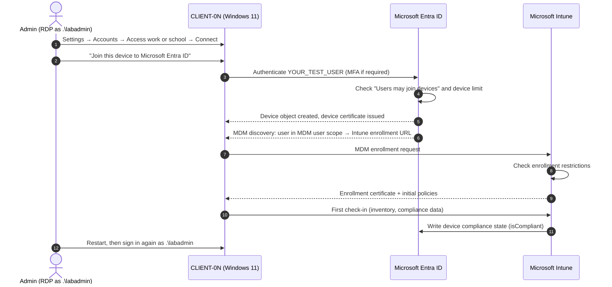

# Device enrollment: Entra join and Intune

[← Documentation home](index.md)

This page explains how to bring `CLIENT-01` and `CLIENT-02` under Intune management. **This is a manual procedure.** Nothing in the repository automates it.

## Contents

- [Device registration vs. join vs. enrollment](#device-registration-vs-join-vs-enrollment)
- [Chosen enrollment method](#chosen-enrollment-method)
- [Enrollment workflow](#enrollment-workflow)
- [Prepare the tenant](#prepare-the-tenant)
- [Enroll each VM](#enroll-each-vm)
- [Validate enrollment](#validate-enrollment)
- [Signing in with the Entra account over RDP (optional)](#signing-in-with-the-entra-account-over-rdp-optional)
- [Common errors](#common-errors)
- [Security implications](#security-implications)
- [References](#references)

## Device registration vs. join vs. enrollment

These terms are often confused. They are separate steps on separate services:

| Term | Service | What it means | Used in this lab? |
|---|---|---|---|
| **Entra registered** | Microsoft Entra ID | A personal device is known to Entra (workplace join); the user signs in to Windows with a local or Microsoft account | No |
| **Entra joined** | Microsoft Entra ID | The device's identity lives in Entra; organizational accounts can sign in to Windows | **Yes** |
| **Entra hybrid joined** | Entra ID + on-prem AD | Joined to on-prem AD and registered in Entra | No (there is no domain controller) |
| **MDM enrolled** | Microsoft Intune | The device's MDM client is enrolled and checks in with Intune, so it can receive policy and report compliance | **Yes** |

Joining creates an **Entra device object**. Enrolling creates an **Intune managed device** object. With automatic enrollment, both happen in a single user action, but they remain two linked records. Conditional Access reads the compliance flag on the **Entra device object**, which Intune writes.

## Chosen enrollment method

**User-driven Microsoft Entra join from Windows Settings, with MDM automatic enrollment.**

Why this method:

- Autopilot, Commercial OOBE, and the Enrollment Status Page are **not supported** on Azure VMs reachable only through RDP. See [Using Windows virtual machines with Intune](https://learn.microsoft.com/intune/solutions/windows-virtual-machines).
- The VMs are not domain-joined, so hybrid join does not apply.
- The repository does not install the `AADLoginForWindows` VM extension. The join therefore happens **inside the guest OS**.

## Enrollment workflow



**Explanation:** The join (steps 1–5) and the enrollment (steps 6–9) happen in one wizard. Enrollment happens automatically only if the test user is in the **MDM user scope**. Otherwise the device is Entra-joined but **not** managed by Intune, which is the most common failure. Step 10 is what Conditional Access later relies on.

## Prepare the tenant

Do this once per tenant. Portal paths may move; use the portal search if needed.

1. **Allow the test user to join devices.**
   Entra admin center → **Identity → Devices → Device settings** → *Users may join devices to Microsoft Entra* → **All** or **Selected** (include `YOUR_TEST_USER`).

2. **Set the MDM user scope.**
   Intune admin center → **Devices → Windows → Enrollment → Automatic Enrollment** → *MDM user scope* → **Some** (a group containing `YOUR_TEST_USER`) or **All**. Leave the MDM URLs at their defaults.

3. **Confirm enrollment restrictions.**
   Intune admin center → **Devices → Enrollment** → *Device platform restrictions*: Windows (MDM) allowed. *Device limit restrictions*: at least 2.

4. **License the test user.** Assign Intune Plan 1 and Entra ID P1, for example through Microsoft 365 E3/E5. See [Prerequisites](prerequisites.md#microsoft-365--entra--intune-licensing).

5. **Create a device group for policy assignment.**
   Entra admin center → **Groups → New group**:

   | Field | Value |
   |---|---|
   | Group type | Security |
   | Name | `GRP-IntuneLab-Devices` (suggested) |
   | Membership type | Assigned (add devices after they join) |

   A dynamic device group also works (Entra ID P1), for example with the rule `(device.displayName -startsWith "CLIENT-0")`. Dynamic membership can take several minutes to process.

## Enroll each VM

Repeat these steps on `CLIENT-01` and `CLIENT-02`.

1. RDP to the VM as `.\labadmin`. See [Setup guide, Step 7](setup-guide.md#step-7-connect-with-rdp).
2. Open **Settings → Accounts → Access work or school → Connect**.
3. Select **Join this device to Microsoft Entra ID**. This is the link at the bottom of the dialog, not the email field.
4. Sign in as `YOUR_TEST_USER@YOUR_TENANT_DOMAIN` and complete MFA if prompted.
5. On *Make sure this is your organization*, verify the tenant and select **Join**.
6. Select **Done**, then restart the VM.
7. RDP back in as `.\labadmin`.

> [!NOTE]
> **Screenshot placeholder, Figure 2:** The *Access work or school* page on a VM after joining, showing "Connected to YOUR_TENANT's Microsoft Entra ID". Redact the tenant name.

After both VMs join, add them to `GRP-IntuneLab-Devices` if you used assigned membership.

## Validate enrollment

### On the VM

```powershell
dsregcmd /status
```

Expected values (excerpt, not literal output):

| Section | Field | Expected |
|---|---|---|
| Device State | `AzureAdJoined` | `YES` |
| Device State | `DomainJoined` | `NO` |
| Tenant Details | `TenantName` | Your tenant |
| Tenant Details | `MdmUrl` | An Intune enrollment URL (non-empty) |

Also check **Settings → Accounts → Access work or school**. Select the connection, then **Info**. The *Device sync status* section should show a recent sync, with a **Sync** button.

### In the Intune admin center

Go to **Devices → Windows → Windows devices** and confirm, for each VM:

| Column / property | Expected |
|---|---|
| Device name | `CLIENT-01` / `CLIENT-02` |
| Managed by | Intune |
| Ownership | Corporate (Entra-joined devices are corporate by default) |
| Model (device Overview) | `Virtual Machine` |
| Primary user | `YOUR_TEST_USER` |
| Last check-in | Recent |

More checks: [Validation and testing](validation-and-testing.md#stage-2-enrollment).

## Signing in with the Entra account over RDP (optional)

The lab works **without** this. You can do everything as `.\labadmin` and test Conditional Access from a browser.

If you want to RDP as the Entra user, extra configuration is needed. The VM was joined in-guest, not through the Azure `AADLoginForWindows` extension. The supported options depend on your client device and Windows build. See [Connect to remote Microsoft Entra joined device](https://learn.microsoft.com/windows/client-management/client-tools/connect-to-remote-aadj-pc). At minimum, you typically need to add the user to the VM's **Remote Desktop Users** group:

```powershell
# Run elevated on the VM. Replace the placeholder.
net localgroup "Remote Desktop Users" /add "AzureAD\YOUR_TEST_USER@YOUR_TENANT_DOMAIN"
```

## Common errors

| Symptom | Likely cause | Fix |
|---|---|---|
| Device appears in Entra but not in Intune | User not in MDM user scope, or missing Intune license | Fix scope/license. Then disconnect from *Access work or school*, delete the stale Entra device, and rejoin. |
| "Something went wrong" / error `0x801c03ed` during join | User not allowed to join devices | Adjust *Users may join devices* |
| Error `0x80180014` | Windows (MDM) platform blocked by enrollment restrictions | Allow Windows in device platform restrictions |
| Error `0x80180026` | A conflicting MDM setting or policy on the device | See [Windows enrollment errors](https://learn.microsoft.com/troubleshoot/mem/intune/device-enrollment/troubleshoot-windows-enrollment-errors) |
| Device limit reached | Test user has too many devices | Remove stale devices or raise the limit |
| `0x8007064c` "machine is already enrolled" | VM was cloned from an enrolled image | Never clone enrolled VMs; redeploy |

Full list: [Troubleshooting → Enrollment](troubleshooting.md#entra-join-and-intune-enrollment).

## Security implications

- The joining user becomes a **local administrator** of the VM by default (Entra *device administrator* settings). Use a dedicated test user.
- Entra-joined VMs carry a device certificate and Primary Refresh Token (PRT). Treat the VMs as trusted corporate devices while they exist, and delete them from Entra and Intune afterwards.
- Do **not** use the **Wipe** remote action. It removes RDP settings, and you lose access.

## References

- [Using Windows virtual machines with Intune](https://learn.microsoft.com/intune/solutions/windows-virtual-machines)
- [Set up automatic enrollment for Windows](https://learn.microsoft.com/mem/intune/enrollment/windows-enroll)
- [Microsoft Entra joined devices](https://learn.microsoft.com/entra/identity/devices/concept-directory-join)
- [Troubleshoot devices by using dsregcmd](https://learn.microsoft.com/entra/identity/devices/troubleshoot-device-dsregcmd)
