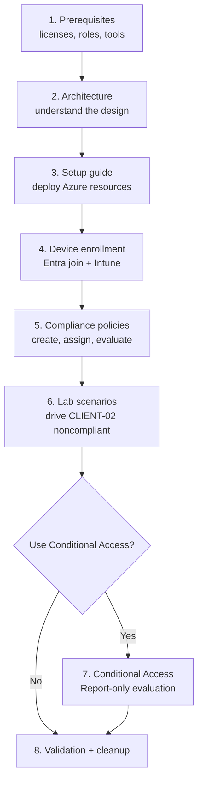

# Documentation home

Welcome to the **Intune Compliance Lab** documentation. This page explains how the documentation is organized and the recommended reading order.

[← Back to README](../README.md)

## How this lab is split

The lab has two layers. It is important to keep them separate:

| Layer | Automated? | What it covers |
|---|---|---|
| **Azure infrastructure** | Yes: Terraform + PowerShell helpers | Resource group, network, NSG, two Windows 11 VMs |
| **Microsoft Entra ID and Intune** | No: manual procedures in these docs | Device join, MDM enrollment, compliance policy, Conditional Access |

The repository also contains one **in-guest** script, [`Set-Client02LabState.ps1`](../Set-Client02LabState.ps1). It runs inside `CLIENT-02` and creates and reverses the noncompliant state.

## Recommended learning path

## Step-by-step lab guide

Prefer a linear path? Follow the numbered guides in order. Each one links back to the reference pages below.

| Step | Guide |
|---|---|
| 00 | [Lab overview](00-lab-overview.md) |
| 01 | [Prerequisites](01-prerequisites.md) |
| 02 | [Azure infrastructure](02-azure-infrastructure.md) |
| 03 | [Intune enrollment](03-intune-enrollment.md) |
| 04 | [Compliance policy](04-compliance-policy.md) |
| 05 | [Conditional Access](05-conditional-access.md) |
| 06 | [Validation and troubleshooting](06-validation-and-troubleshooting.md) |
| 07 | [Cleanup](07-cleanup.md) |

## Document map

| # | Document | Audience | Purpose |
|---|---|---|---|
| 1 | [Prerequisites](prerequisites.md) | Everyone | Licenses, roles, tools, cost |
| 2 | [Architecture](architecture.md) | Everyone | Topology, component relationships, design decisions, VM limitations |
| 3 | [Setup guide](setup-guide.md) | Everyone | Terraform deployment, outputs, RDP, teardown |
| 4 | [Device enrollment](device-enrollment.md) | Intune admins | Entra join and automatic MDM enrollment of Azure VMs |
| 5 | [Compliance policies](compliance-policies.md) | Intune admins | Configuration vs. compliance, policy design, evaluation, lifecycle |
| 6 | [CLIENT-02 lab script](client02-lab-script.md) | Everyone | Reference for `Set-Client02LabState.ps1` |
| 7 | [Conditional Access](conditional-access.md) | Identity admins | Optional enforcement using device compliance |
| 8 | [Lab scenarios](lab-scenarios.md) | Everyone | Step-by-step exercises |
| 9 | [Post-deployment checklist](intune-configuration.md) | Experienced admins | Condensed checklist of the manual steps |
| 10 | [Validation and testing](validation-and-testing.md) | Everyone | Evidence to collect at each stage |
| 11 | [Troubleshooting](troubleshooting.md) | Everyone | Symptoms, causes, fixes |
| 12 | [Security considerations](security-considerations.md) | Everyone | Risks and safe operation for a public lab |
| 13 | [FAQ](faq.md) | Everyone | Quick answers |
| 14 | [Glossary](glossary.md) | Beginners | Terminology |

## Conventions used in these docs

- **Placeholders** use the `YOUR_*` form, for example `YOUR_TENANT_DOMAIN`, `YOUR_SUBSCRIPTION_ID`, `YOUR_PUBLIC_IP`, `YOUR_ADMIN_ACCOUNT`, `YOUR_TEST_USER`. Replace them locally. Never commit real values.
- **Documentation IP ranges** (`203.0.113.0/24`, `198.51.100.0/24`) are reserved for examples and will not work as real addresses.
- **Portal navigation paths** reflect the Microsoft Intune admin center and Microsoft Entra admin center at the time of writing. Microsoft moves blades occasionally. If a path differs, use the portal search.
- **"Implemented"** means the repository contains code for it. **"Manual"** means you perform it in a portal using these docs. **"Suggested"** means it is not in the repository.
- **Estimated durations** are estimates only. Intune check-in and reporting latency varies.

## Screenshots

This repository does not yet contain real portal screenshots. Places where a screenshot would help are marked as **screenshot placeholders**. The capture list is in [images/README.md](images/README.md).
