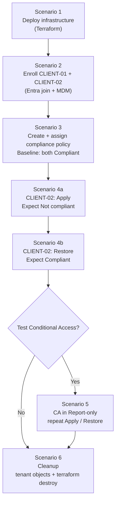

# Lab scenarios

[← Documentation home](index.md)

Six guided scenarios take you from an empty subscription to a tested compliance and Conditional Access setup, and back to a clean state. Run them in order.

> [!NOTE]
> Durations are **estimates**. Intune check-in and reporting latency can add 15 minutes or more to any step that waits for compliance.

## End-to-end workflow



## Overview

| # | Scenario | Difficulty | Est. duration | Automated? |
|---|---|---|---|---|
| 1 | [Deploy the lab infrastructure](#scenario-1-deploy-the-lab-infrastructure) | Beginner | 20–40 min | Yes (Terraform) |
| 2 | [Enroll both VMs into Intune](#scenario-2-enroll-both-vms-into-intune) | Beginner | 20–30 min | No |
| 3 | [Create a compliance policy and baseline](#scenario-3-create-a-compliance-policy-and-baseline) | Intermediate | 30–60 min | No |
| 4 | [Drive CLIENT-02 noncompliant and recover](#scenario-4-drive-client-02-noncompliant-and-recover) | Intermediate | 30–60 min | Partly (in-guest script) |
| 5 | [Conditional Access in Report-only (optional)](#scenario-5-conditional-access-in-report-only-optional) | Advanced | 30–60 min | No |
| 6 | [Cleanup](#scenario-6-cleanup) | Beginner | 15–30 min | Partly (Terraform) |

---

## Scenario 1: Deploy the lab infrastructure

| | |
|---|---|
| **Difficulty** | Beginner |
| **Estimated duration** | 20–40 minutes |
| **Roles** | Azure Contributor |
| **Prerequisites** | [Prerequisites](prerequisites.md) |

**Learning objectives:** Deploy repeatable infrastructure with Terraform; understand how the NSG limits exposure.

**Steps:** Follow the [Setup guide](setup-guide.md), Steps 1–7.

**Expected results:**

- `terraform apply` completes with 13 resources added.
- `terraform output` lists both VM names and public IPs.
- RDP as `.\labadmin` works from your IP. From any other IP, the connection times out.

**Validation:** [Validation → Stage 1](validation-and-testing.md#stage-1-infrastructure).

**Troubleshooting:** [Terraform and Azure deployment](troubleshooting.md#terraform-and-azure-deployment).

**Cleanup:** Covered in [Scenario 6](#scenario-6-cleanup).

---

## Scenario 2: Enroll both VMs into Intune

| | |
|---|---|
| **Difficulty** | Beginner |
| **Estimated duration** | 20–30 minutes |
| **Roles** | Intune Administrator; Cloud Device Administrator (device settings); Groups Administrator |
| **Prerequisites** | Scenario 1; licensed `YOUR_TEST_USER` |

**Learning objectives:** Tell Entra join apart from MDM enrollment; configure MDM user scope; confirm a VM is detected as a virtual machine.

**Environment preparation:** Complete [Prepare the tenant](device-enrollment.md#prepare-the-tenant) (join permissions, MDM user scope, restrictions, and the device group `GRP-IntuneLab-Devices`).

**Steps:**

1. On `CLIENT-01`, follow [Enroll each VM](device-enrollment.md#enroll-each-vm).
2. Repeat on `CLIENT-02`.
3. Add both devices to `GRP-IntuneLab-Devices` (assigned membership), or confirm that dynamic membership includes them.

**Expected results:**

| Check | CLIENT-01 | CLIENT-02 |
|---|---|---|
| `dsregcmd /status` → `AzureAdJoined` | YES | YES |
| Intune → Windows devices → Managed by | Intune | Intune |
| Model | Virtual Machine | Virtual Machine |

**Validation:** [Validation → Stage 2](validation-and-testing.md#stage-2-enrollment).

**Troubleshooting:** [Entra join and Intune enrollment](troubleshooting.md#entra-join-and-intune-enrollment).

**Cleanup:** Covered in [Scenario 6](#scenario-6-cleanup).

---

## Scenario 3: Create a compliance policy and baseline

| | |
|---|---|
| **Difficulty** | Intermediate |
| **Estimated duration** | 30–60 minutes, including check-in wait |
| **Roles** | Intune Administrator or Policy and Profile Manager |
| **Prerequisites** | Scenario 2 |

**Learning objectives:** Build a Windows compliance policy; understand that it evaluates without configuring; read per-setting results.

**Steps:**

1. Create `CP-Win-IntuneLab-Baseline` with the [recommended settings](compliance-policies.md#recommended-lab-policy), and assign it to `GRP-IntuneLab-Devices`. See [Create and assign the policy](compliance-policies.md#create-and-assign-the-policy).
2. On **both** VMs, confirm the starting state:

   ```powershell
   # Elevated PowerShell on CLIENT-01 and CLIENT-02
   Get-NetFirewallProfile | Select-Object Name, Enabled
   Get-MpComputerStatus | Select-Object AntivirusEnabled, RealTimeProtectionEnabled, IsTamperProtected
   ```

3. **Sync** both devices (Access work or school → Info → Sync, or from the Intune admin center).
4. Wait for the evaluation, then open each device → **Device compliance** → `CP-Win-IntuneLab-Baseline`.

**Configuration details:** See the policy table in [Compliance policies](compliance-policies.md#recommended-lab-policy).

**Expected results:** Both devices are **Compliant**, with every configured setting **Compliant**. If CLIENT-01 is not compliant at this point, fix that before continuing. Common causes are outdated security intelligence and a recently rebooted device that reports **Error** for Firewall.

**Validation:** [Validation → Stages 3 and 4](validation-and-testing.md#stage-3-policy-assignment).

**Troubleshooting:** [Compliance evaluation](troubleshooting.md#compliance-evaluation).

**Cleanup:** Covered in [Scenario 6](#scenario-6-cleanup).

---

## Scenario 4: Drive CLIENT-02 noncompliant and recover

| | |
|---|---|
| **Difficulty** | Intermediate |
| **Estimated duration** | 30–60 minutes, including two check-in waits |
| **Roles** | Local administrator on CLIENT-02; Intune read access |
| **Prerequisites** | Scenario 3 with both devices Compliant |

**Learning objectives:** Observe drift detection; understand check-in latency; see how Tamper Protection affects Defender changes; recover a device.

> [!CAUTION]
> `Apply` disables Windows Firewall on all profiles of an Internet-reachable VM. Keep this phase short, and run `Restore` as soon as you have your evidence. See [Security considerations](security-considerations.md).

**Environment preparation:** Copy [`Set-Client02LabState.ps1`](../Set-Client02LabState.ps1) to `CLIENT-02`, for example by pasting it into Notepad over RDP and saving it as `C:\Lab\Set-Client02LabState.ps1`. Full reference: [CLIENT-02 lab script](client02-lab-script.md).

### 4a: Apply drift

```powershell
# Elevated PowerShell on CLIENT-02
cd C:\Lab
Set-ExecutionPolicy -Scope Process Bypass -Force
.\Set-Client02LabState.ps1 -Action Status
.\Set-Client02LabState.ps1 -Action Apply
```

1. Read the **"Actual state after Apply"** section. Note whether `RealTimeProtectionEnabled` actually became `False`. If Tamper Protection blocked it, the script prints a warning.
2. Sync `CLIENT-02`.
3. In Intune, open `CLIENT-02` → **Device compliance** → policy → per-setting view.

**Expected results:**

| Setting | Expected state |
|---|---|
| Firewall | **Not compliant** |
| Real-time protection | Not compliant **only if** RTP was actually disabled |
| Antivirus / Antispyware | Depends on Windows Security Center reporting. Record what you see. |
| Device overall | **Not compliant** |
| CLIENT-01 | Still Compliant (control) |

> [!NOTE]
> **Screenshot placeholder, Figure 6:** CLIENT-02 per-setting compliance view showing Firewall = Not compliant.

### 4b: Recover

```powershell
.\Set-Client02LabState.ps1 -Action Restore
```

1. Confirm that the "Actual state after Restore" shows the firewall profiles enabled and RTP restored.
2. Sync `CLIENT-02`, then wait for re-evaluation.

**Expected result:** `CLIENT-02` returns to **Compliant**.

**Validation:** [Validation → Stage 5](validation-and-testing.md#stage-5-drift-and-recovery).

**Troubleshooting:** [Drift script](troubleshooting.md#client-02-drift-script).

**Cleanup:** `Restore` is the cleanup for this scenario. The backup is kept as `Client02-protection-state.json.restored-<timestamp>` under `%ProgramData%\IntuneLab`.

---

## Scenario 5: Conditional Access in Report-only (optional)

| | |
|---|---|
| **Difficulty** | Advanced |
| **Estimated duration** | 30–60 minutes |
| **Roles** | Conditional Access Administrator; Reports Reader (sign-in logs) |
| **Prerequisites** | Scenario 4 completed; emergency access account exists; Entra ID P1 |

**Learning objectives:** See how compliance becomes an access decision; use Report-only safely; interpret sign-in logs.

**Steps:**

1. Create `CA-IntuneLab-RequireCompliantDevice-ReportOnly`. See [Create the policy](conditional-access.md#create-the-policy-report-only).
2. Sign in to `https://www.office.com` as `YOUR_TEST_USER` from `CLIENT-01`.
3. On `CLIENT-02`, run `-Action Apply`, sync, confirm **Not compliant** in Intune, then sign in the same way.
4. Run `-Action Restore`, sync, confirm **Compliant**, and sign in again.
5. Review each sign-in's **Device info** and **Report-only** tabs.

**Expected results:** See [Read the results](conditional-access.md#read-the-results).

**Validation:** [Validation → Stage 6](validation-and-testing.md#stage-6-conditional-access).

**Troubleshooting:** [Conditional Access](troubleshooting.md#conditional-access).

**Cleanup:** Delete or disable the CA policy in Scenario 6.

---

## Scenario 6: Cleanup

| | |
|---|---|
| **Difficulty** | Beginner |
| **Estimated duration** | 15–30 minutes |
| **Roles** | All roles used above; Azure Contributor |

Clean up the **tenant** first, while you still know which objects belong to the lab.

1. **Restore CLIENT-02** if it is still in the `Apply` state (`-Action Restore`).
2. **Conditional Access:** Delete `CA-IntuneLab-RequireCompliantDevice-ReportOnly`, or set it to **Off**.
3. **Compliance policy:** Delete `CP-Win-IntuneLab-Baseline`.
4. **Intune devices:** Intune admin center → Devices → select each VM → **Delete**. Do **not** use **Wipe**.
5. **Entra devices:** Entra admin center → Devices → All devices → delete `CLIENT-01` and `CLIENT-02`.
6. **Groups:** Delete `GRP-IntuneLab-Devices` (and `GRP-IntuneLab-Users` if you created it).
7. **Tenant settings:** Revert any tenant-wide changes you made only for the lab: MDM user scope, device join settings, compliance settings, and security defaults.
8. **Azure:** From `terraform\`, run `..\scripts\destroy.ps1`. See [Teardown](setup-guide.md#teardown).
9. **Local files:** Delete `terraform.tfvars`, `terraform.tfstate*`, and `.terraform\` from your workstation once you no longer need them. They contain your IP and the admin password.

**Validation:**

```powershell
az group exists --name intune-lab-rg     # expected: false
```

Confirm in both admin centers that the lab devices, policies, and groups are gone.
