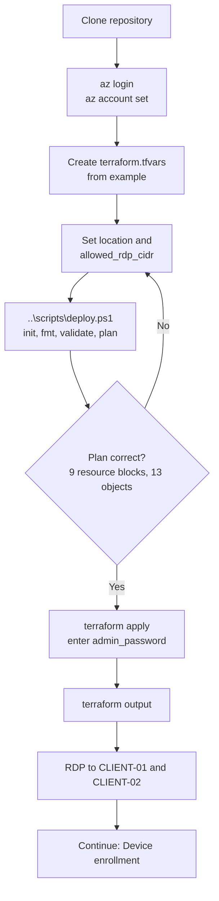

# Setup guide: deploy the Azure infrastructure

[← Documentation home](index.md)

This guide deploys the Azure layer of the lab with Terraform. It ends when you can RDP into both VMs. Intune and Entra configuration continue in [Device enrollment](device-enrollment.md).

| | |
|---|---|
| **Difficulty** | Beginner |
| **Estimated duration** | 20–40 minutes (estimate; VM provisioning time varies by region) |
| **Required role** | Azure Contributor on the target subscription |
| **Prerequisites** | [Prerequisites](prerequisites.md) completed |

## Deployment workflow



## Step 1: Clone the repository

```powershell
git clone https://github.com/emadadel2008/intune-compliance-lab.git
cd intune-compliance-lab\terraform
```

If you work from a fork, replace the URL with your fork. **All Terraform and helper-script commands in this guide run from the `terraform` directory.**

## Step 2: Authenticate to Azure

The azurerm provider uses your Azure CLI login.

```powershell
az login
az account list --output table
az account set --subscription "YOUR_SUBSCRIPTION_ID"
az account show --output table
```

Confirm that `az account show` displays the intended subscription. Terraform deploys to whichever subscription is active.

## Step 3: Create your local variables file

```powershell
Copy-Item .\terraform.tfvars.example .\terraform.tfvars
notepad .\terraform.tfvars
```

`terraform.tfvars` is excluded by [`.gitignore`](../.gitignore). Do not rename it to anything that is not ignored.

> [!WARNING]
> Create and edit `terraform.tfvars` **before** running `scripts\deploy.ps1`. If the file is missing, the script copies the example and opens Notepad, **but it does not wait for you to save**. It continues straight into `terraform plan` with the example values. The example `allowed_rdp_cidr` (`203.0.113.10/32`) passes validation but is a documentation address, so RDP will not work.

### Variable reference

| Variable | Required | Default | Validation / notes |
|---|---|---|---|
| `allowed_rdp_cidr` | **Yes** | none | Must be a valid IPv4 CIDR ending in `/32`. Use `YOUR_PUBLIC_IP/32`. |
| `admin_password` | **Yes** | none | Sensitive. At least 12 characters (Terraform check). Azure also enforces complexity rules. Do **not** put it in `terraform.tfvars`. |
| `location` | No | `uaenorth` | Any region with the image, size, and capacity |
| `project_name` | No | `intune-lab` | 3–16 chars, `[a-z0-9-]`; prefixes most resource names |
| `vm_size` | No | `Standard_B2ms` | Must support Trusted Launch and be available in the region |
| `admin_username` | No | `labadmin` | Local administrator name |
| `windows_sku` | No | `win11-24h2-ent` | Marketplace SKU |
| `windows_publisher` / `windows_offer` / `windows_version` | No | `MicrosoftWindowsDesktop` / `Windows-11` / `latest` | Marketplace image reference |
| `license_type` | No | `Windows_Client` | Set only if you have eligible Windows licensing |
| `address_space` / `subnet_prefix` | No | `10.40.0.0/16` / `10.40.1.0/24` | Change only if they overlap with networks you peer with |

Find your public IPv4 address from a trusted source, for example:

```powershell
(Invoke-RestMethod -Uri "https://api.ipify.org")
```

Then set `allowed_rdp_cidr = "YOUR_PUBLIC_IP/32"`.

## Step 4: Run pre-flight checks

```powershell
..\scripts\deploy.ps1
```

[`scripts/deploy.ps1`](../scripts/deploy.ps1) performs these steps and stops on the first failure:

1. Verifies `terraform` and `az` are on `PATH`.
2. Runs `az account show` to confirm you are signed in.
3. Creates `terraform.tfvars` from the example if missing (see the warning above).
4. Runs `terraform init`, `terraform fmt -recursive`, `terraform validate`, and `terraform plan`.

It does **not** apply. `terraform plan` prompts for `admin_password` unless `TF_VAR_admin_password` is set. Planning also works with a throwaway value of at least 12 characters, because nothing is created.

**What to check in the plan:**

- It shows **13 resources to add**: 1 resource group, 1 VNet, 1 subnet, 1 NSG, 1 NSG rule, 2 NSG associations, 2 public IPs, 2 NICs, and 2 VMs.
- `azurerm_network_security_rule.allow_rdp` shows `source_address_prefix = "YOUR_PUBLIC_IP/32"`, **not** `"*"`.
- Nothing is planned to change or be destroyed (on a first deployment).

## Step 5: Apply

Supply the password through an environment variable so that it never touches disk in the repository:

```powershell
$env:TF_VAR_admin_password = Read-Host "Enter a strong local admin password" -AsSecureString |
    ForEach-Object { [System.Net.NetworkCredential]::new("", $_).Password }

terraform apply

Remove-Item Env:TF_VAR_admin_password
```

Review the plan again and type `yes`.

> [!CAUTION]
> `sensitive = true` hides the password in CLI output only. The password is stored in plain text in `terraform.tfstate`. Protect the state file. Both `*.tfstate` and `*.tfstate.*` are git-ignored.

## Step 6: Read the outputs

```powershell
terraform output
```

| Output | Content |
|---|---|
| `resource_group_name` | For example, `intune-lab-rg` |
| `vm_names` | Map: `client-01 → CLIENT-01`, `client-02 → CLIENT-02` |
| `public_ips` | Map of each VM's public IPv4 address |
| `rdp_username` | Local administrator user name |

## Step 7: Connect with RDP

```powershell
mstsc /v:CLIENT_01_PUBLIC_IP
```

Sign in as `.\labadmin` (or your `admin_username`). The `.\` prefix forces a local account, which matters after the device is Entra-joined.

On first sign-in, let Windows finish its setup and install pending updates if possible. Repeat for `CLIENT-02`.

**Expected result:** You reach the desktop of both VMs. Connections from any other source address time out.

> [!NOTE]
> **Screenshot placeholder, Figure 1:** `terraform output` showing the four outputs, with public IPs **redacted**. See [images/README.md](images/README.md).

## Day-2 operations

### Your public IP changed

```powershell
notepad .\terraform.tfvars      # update allowed_rdp_cidr
terraform apply                  # updates the NSG rule in place
```

### Stop paying for compute between sessions

```powershell
az vm deallocate --resource-group intune-lab-rg --name CLIENT-01
az vm deallocate --resource-group intune-lab-rg --name CLIENT-02

# Later
az vm start --resource-group intune-lab-rg --name CLIENT-01
az vm start --resource-group intune-lab-rg --name CLIENT-02
```

Static public IPs are preserved across deallocation. Disks and public IPs continue to incur charges.

### Upgrading from a version with open RDP

If you deployed before the NSG fix in [CHANGELOG.md](../CHANGELOG.md), run `terraform plan`. It shows the RDP rule being **replaced**, because the rule name changed. Apply it to restrict RDP to your `/32`.

## Teardown

From the `terraform` directory, with the same state file:

```powershell
..\scripts\destroy.ps1
```

[`scripts/destroy.ps1`](../scripts/destroy.ps1) runs `terraform plan -destroy` and asks you to type `DESTROY` (case-sensitive). Only then does it run `terraform destroy`, which asks for confirmation again. You can also run `terraform destroy` directly.

Before or after destroying, also clean up the tenant side. See [Scenario 6: Cleanup](lab-scenarios.md#scenario-6-cleanup).

## Troubleshooting

See [Troubleshooting → Terraform and Azure](troubleshooting.md#terraform-and-azure-deployment).
