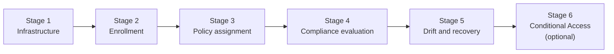

# Validation and testing

[← Documentation home](index.md)

Use this page to collect **evidence** at each stage of the lab. Each check lists the command or portal view and the expected result. Expected results are predictions. Record what you **actually** observe in the [evidence log](#evidence-log-template).

> [!NOTE]
> No test results are recorded in this repository. Example outputs below describe the shape of the expected data, not captured output.

## Validation stages



## Static checks (repository)

Run these from `terraform\` before deploying or after changing Terraform files:

```powershell
terraform fmt -check -recursive
terraform init -backend=false
terraform validate
```

Expected: `fmt` produces no output and exits 0; `validate` prints `Success! The configuration is valid.`

To check PowerShell syntax without running the scripts:

```powershell
foreach ($f in '..\Set-Client02LabState.ps1', '..\scripts\deploy.ps1', '..\scripts\destroy.ps1') {
    $errors = $null
    [System.Management.Automation.Language.Parser]::ParseFile((Resolve-Path $f), [ref]$null, [ref]$errors) | Out-Null
    "{0}: {1} parse error(s)" -f $f, $errors.Count
}
```

## Stage 1: Infrastructure

| # | Check | Command / location | Expected |
|---|---|---|---|
| 1.1 | Resource group exists | `az group show --name intune-lab-rg --query properties.provisioningState -o tsv` | `Succeeded` |
| 1.2 | VMs running | `az vm list -g intune-lab-rg -d --query "[].{name:name, power:powerState}" -o table` | Both `VM running` |
| 1.3 | RDP rule source is your IP | `az network nsg rule show -g intune-lab-rg --nsg-name intune-lab-nsg -n Allow-RDP-From-Admin-IP --query "{source:sourceAddressPrefix, port:destinationPortRange, access:access}"` | `source` = `YOUR_PUBLIC_IP/32`, port `3389`, `Allow` |
| 1.4 | Trusted Launch enabled | `az vm show -g intune-lab-rg -n CLIENT-01 --query securityProfile` | `securityType: TrustedLaunch`, `secureBootEnabled: true`, `vTpmEnabled: true` |
| 1.5 | RDP reachable from your IP | `Test-NetConnection -ComputerName CLIENT_01_PUBLIC_IP -Port 3389` | `TcpTestSucceeded : True` |
| 1.6 | RDP **not** reachable elsewhere | Repeat 1.5 from a different network (for example, a phone hotspot) | `TcpTestSucceeded : False` |

## Stage 2: Enrollment

| # | Check | Command / location | Expected |
|---|---|---|---|
| 2.1 | Entra joined | On VM: `dsregcmd /status` | `AzureAdJoined : YES` |
| 2.2 | MDM URL set | On VM: `dsregcmd /status` → Tenant Details | `MdmUrl` non-empty |
| 2.3 | Managed by Intune | Intune → Devices → Windows | Both VMs listed, *Managed by* = Intune |
| 2.4 | Detected as VM | Device → Overview → Model | `Virtual Machine` |
| 2.5 | MDM events healthy | On VM: Event Viewer → *Applications and Services Logs → Microsoft → Windows → DeviceManagement-Enterprise-Diagnostics-Provider → Admin* | No recurring errors after enrollment |

Optional, with Microsoft Graph PowerShell (read-only scopes):

```powershell
Connect-MgGraph -Scopes "DeviceManagementManagedDevices.Read.All", "Device.Read.All"

Get-MgDeviceManagementManagedDevice -All |
    Where-Object DeviceName -like "CLIENT-0*" |
    Select-Object DeviceName, ManagementAgent, Model, ComplianceState, LastSyncDateTime

Get-MgDevice -All |
    Where-Object DisplayName -like "CLIENT-0*" |
    Select-Object DisplayName, TrustType, IsManaged, IsCompliant
```

Expected: `Model` = `Virtual Machine`; `TrustType` = `AzureAd`; `IsManaged` = `True`.

## Stage 3: Policy assignment

| # | Check | Location | Expected |
|---|---|---|---|
| 3.1 | Group membership | Entra → Groups → `GRP-IntuneLab-Devices` → Members | Both devices |
| 3.2 | Policy assigned | Intune → Devices → Compliance → `CP-Win-IntuneLab-Baseline` → Properties → Assignments | Included group = `GRP-IntuneLab-Devices` |
| 3.3 | Policy reached device | Device → Device compliance | Policy listed (not only *Default Device Compliance Policy*) |

## Stage 4: Compliance evaluation

| # | Check | Location | Expected (baseline) |
|---|---|---|---|
| 4.1 | Local state | On each VM: `.\Set-Client02LabState.ps1 -Action Status` (or the `Get-NetFirewallProfile` / `Get-MpComputerStatus` commands) | Firewall enabled on all profiles; `RealTimeProtectionEnabled : True` |
| 4.2 | Per-setting results | Device → Device compliance → policy | Every configured setting Compliant |
| 4.3 | Device state | Devices → Windows → *Compliance* column | Compliant for both |
| 4.4 | Entra flag | `Get-MgDevice` (above) → `IsCompliant` | `True` for both |

Per-policy state with Graph:

```powershell
$device = Get-MgDeviceManagementManagedDevice -All | Where-Object DeviceName -eq "CLIENT-02"
Get-MgDeviceManagementManagedDeviceCompliancePolicyState -ManagedDeviceId $device.Id |
    Select-Object DisplayName, State, SettingCount
```

## Stage 5: Drift and recovery

| # | Step | Expected |
|---|---|---|
| 5.1 | `-Action Apply` on CLIENT-02 | Backup written to `%ProgramData%\IntuneLab\Client02-protection-state.json`; Firewall profiles `False` |
| 5.2 | Check `RealTimeProtectionEnabled` in Apply output | `False`, **or** a warning that Tamper Protection or policy blocked the change |
| 5.3 | Sync CLIENT-02, wait | Device → Device compliance → Firewall = **Not compliant**; device = **Not compliant** |
| 5.4 | CLIENT-01 (control) | Still **Compliant** |
| 5.5 | `-Action Restore` | Firewall profiles back to their original values; backup renamed `.restored-<timestamp>` |
| 5.6 | Sync CLIENT-02, wait | Device returns to **Compliant**; `IsCompliant` = `True` |

To trigger a sync from Graph (needs the privileged scope `DeviceManagementManagedDevices.PrivilegedOperations.All`):

```powershell
Sync-MgDeviceManagementManagedDevice -ManagedDeviceId $device.Id
```

## Stage 6: Conditional Access

| # | Check | Location | Expected |
|---|---|---|---|
| 6.1 | Policy state | CA → Policies | `Report-only` |
| 6.2 | Device identified | Sign-in → Device info | Device ID present, Join type Entra joined |
| 6.3 | CLIENT-01 result | Sign-in → Report-only | `Report-only: Success` |
| 6.4 | CLIENT-02 (Applied) result | Sign-in → Report-only | `Report-only: Failure` |
| 6.5 | CLIENT-02 (Restored) result | Sign-in → Report-only | `Report-only: Success` |

With Graph (`AuditLog.Read.All`):

```powershell
Connect-MgGraph -Scopes "AuditLog.Read.All"
Get-MgAuditLogSignIn -Filter "userPrincipalName eq 'YOUR_TEST_USER@YOUR_TENANT_DOMAIN'" -Top 10 |
    ForEach-Object {
        [pscustomobject]@{
            Time      = $_.CreatedDateTime
            Device    = $_.DeviceDetail.DisplayName
            Compliant = $_.DeviceDetail.IsCompliant
            LabPolicy = ($_.AppliedConditionalAccessPolicies |
                         Where-Object DisplayName -like "CA-IntuneLab*").Result
        }
    }
```

Expected `LabPolicy` values: `reportOnlySuccess` or `reportOnlyFailure`.

## Evidence log template

Copy this table into your own notes. Do **not** commit it with real identifiers.

| Date/time (UTC) | Stage/check | Device | Action | Observed result | Matches expected? | Notes |
|---|---|---|---|---|---|---|
| | 1.3 | n/a | NSG rule source | | | |
| | 2.3 | CLIENT-01 | Enrollment | | | |
| | 4.3 | CLIENT-02 | Baseline compliance | | | |
| | 5.3 | CLIENT-02 | After Apply | | | |
| | 5.6 | CLIENT-02 | After Restore | | | |
| | 6.4 | CLIENT-02 | CA Report-only | | | |
